# Astraea Master Game Design

Living design and production specification

Version 0.3 · 1 October 2026 · Main eighteen deck build

Astraea is a cozy first-person custodial game aboard the Astraea Grand Voyager, an enormous original luxury liner owned by SunCorp. The player does practical, physical work while a persistent population of six species goes about its holiday. A shift creates a small, satisfying story: learn a neighborhood, care for its spaces, navigate an awkward cart, meet somebody, earn wages, and decide what can be sent home or made more comfortable aboard.

This master document brings the ship, its people, work, economy, fiction, art, sound and production requirements into one editable reference. It preserves confirmed direction, records what the current Godot build actually does, and gives the unbuilt systems enough structure to discuss and implement. Proposed detail remains a proposal until accepted. A system appearing in code does not mean its art, balance or player experience has passed review.

The confirmed current priority is to fully realize the ship and its mostly automated life: staff and guests must live, enjoy leisure and work properly throughout it before the storyline, exact questline and detailed player gameplay are developed. Earlier custodial, financial and SunCorp aspirations remain the setting and future design direction. Existing cleaning and economy systems are retained as working prototypes; they are not a final gameplay specification. The D09 Composition04 direction is now approved for propagation and substantial further refinement. Full-ship completion and final art acceptance remain open; the earlier care-alcove approval was local.

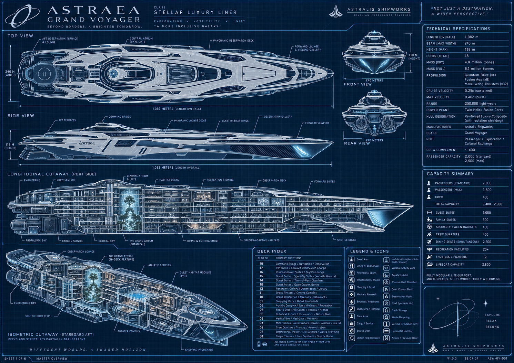

Reference plate 1. User-supplied Astraea overview. The silhouette, scale and linked districts guide the project. The corrected accommodation ledger in this document supersedes conflicting printed totals in the image. This is a planning reference, not a capture of the game.

<!-- pagebreak -->

## Document control and navigation

The editable Word edition is the review copy. This Markdown source is the text master for version-controlled project work. Keep the two in step when accepting decisions. Source images remain reference material; the game must use original production assets.

| Field | Current value |
|---|---|
| Ship | Astraea Grand Voyager |
| Owner | SunCorp |
| Game working title | Astraea Many Small Worlds |
| Engine snapshot | Godot 4.6.3 using Compatibility |
| Design baseline | One main eighteen deck ship |
| Normal full population | 2,000 passengers and 400 crew |
| Document version | 0.3 |
| Current phase | Realize the full ship and autonomous staff and guest life |
| Snapshot date | 1 October 2026 UTC |
| Review state | Living specification; visual approval and final acceptance outstanding |

### Reading the status labels

- CONFIRMED: established creative direction or an accepted reconciliation of the ship plan
- PROPOSED: new design detail, sample content or tuning offered for review; it does not become canon by appearing here
- IMPLEMENTED: present in the inspected main build or described by its current source documentation
- VERIFIED: a particular behavior has named test or inspection evidence; the evidence applies to that revision and scope only
- UNFINISHED: absent, incomplete, under revision or awaiting the relevant acceptance check
- DEFERRED: retained for a later phase; detail remains proposed until separately agreed

These labels describe different things and may overlap. An IMPLEMENTED feature can be UNFINISHED as an experience. VERIFIED arithmetic is not visual approval. Current numerical tuning is an implementation baseline, not a confirmed long-term balance decision.

### How to maintain this document

Record accepted proposals as decisions and update dependent systems. Refresh implementation status with matching evidence. Keep capacities, controls, prices and source images synchronized. Preserve open questions, and increment the version when scope or a major milestone changes.

### Contents

1. Game identity and design principles
2. Player role and the shape of a day
3. SunCorp and the wider fiction
4. Canonical ship scale and deck plan
5. Spatial design and transport
6. Cabins habitats and room design
7. Ship systems and the service network
8. People and species design
9. Guest needs and daily life
10. Families children and social relationships
11. Staff and the custodial team
12. Shift planning and gentle dispatch
13. Cleaning diversity and incident design
14. Tools products and the physical cart
15. Money wages and sending funds home
16. Shopping decoration and domestic spaces
17. Progression and unlocks
18. Quests and narrative content
19. Recreation and mini games
20. Dialogue and communication
21. Art direction and architectural craft
22. Animation and physical expression
23. Sound music and acoustic identity
24. Interface controls and accessibility
25. Simulation streaming and persistence
26. Implementation status and evidence
27. Production roadmap and asset checklist
28. Acceptance testing and release gates
29. Decision register and open questions
30. Reference plates and blueprint crosswalk
31. Glossary source register and change log
32. Governing architectural requirements
33. Dated destination review baseline

<!-- pagebreak -->

## 1 Game identity and design principles

Status: CONFIRMED core direction. The production rules below translate that direction into reviewable requirements.

### The central promise

Astraea should feel like having a humble but useful job inside a strange holiday town. The player is not responsible for cleaning 2,400 people's entire world. They contribute to a ship that continues without them. Physical care supplies tactile satisfaction; observing guests supplies curiosity; familiar staff and improving personal spaces supply belonging. SunCorp's unequal priorities provide quiet tension beneath the hospitality.

Scale matters because the player gradually learns places and people. The liner is not a compact room dressed with a large number in a menu. Its long streets, stacked terraces, neighborhoods, support spaces and leisure destinations must be connected, legible and materially different. Distance should create anticipation and local identity without turning every errand into an exhausting commute.

### Current phase priority

CONFIRMED on 1 October 2026: finish the full ship and the mostly autonomous life it supports before developing the storyline and exact gameplay detail. The creator states: “our main goal right now is to nail the full ship build and the mostly automated life it leads.” Staff and guests must live, enjoy leisure and work properly throughout the vessel. This governs sequencing across the document.

The current phase includes coherent architecture, connected movement, useful destinations, physically supported activities, individual needs and dependable staff routines. It must be evident during ordinary observation and travel, with persistent people and purposeful spaces. A complete registry or passing model alone cannot establish this outcome.

The detailed quests, tutorials, cleaning variants, rewards, progression pacing and economic values below are retained as proposals or prototype evidence for later decisions. They are not an approved exact questline or final player experience. SunCorp, the custodial premise and earlier aspirations remain available to guide the setting without requiring story production now. The D09 Composition04 direction is approved for propagation and further refinement. It remains a local step toward the full ship rather than final shipwide acceptance.

### Core promises

- Work is physical and understandable. The cart has weight, bottles are objects, supplies run out, and a mess visibly changes as it is cleaned
- The ship is alive for reasons. A guest leaves a trace because they ate, socialized or used a facility, not because the camera needs another random decal
- The six species have distinct confirmed bodies and habits, including Humans. Individuality sits alongside those traits; Mindos are recognized sentient people with recently received rights
- Work is gentle. Headset suggestions, background colleagues and bounded tasks leave room to wander and enjoy the liner
- Wages create personal choices. The fictional worker weighs money home against a bedroom, a shared breakroom and useful equipment
- Craft carries the image. Modeled shape, low-resolution materials and fixture light must do the work before postprocessing
- The setting remains original. Reference works inform individual qualities, not copied characters, branding, geometry or layouts

### Design boundaries

The confirmed focus is a single-player first-person custodial experience. Combat, survival horror, real-money purchases, multiplayer, harmful alien biology simulation and a complete ship-management tycoon are outside this baseline. They should not be introduced as dependencies of the core loop. SunCorp can be exploitative without turning every interaction into a threat or every staff room into a horror corridor.

A feature earns its place by improving care, observation, belonging or the sense of a lived-in vessel. Large systems should first connect to one of those experiences. A stock market, full retail supply economy or detailed propulsion simulator would add substantial production cost without a currently established player need.

### Acceptance

The immediate phase passes when the full ship reads as a coherent inhabited vessel and staff and guests demonstrably live, take leisure and work through its destinations. Coverage must include architectural identity, real circulation, activity support, staff service and persistence. The following player-loop criteria belong to the later gameplay phase and do not set an approved tutorial or questline.

A first-time player can explain their job after one guided incident; can take a voluntary detour without losing their shift; can identify a guest activity that caused work; and can see a meaningful wage choice at the end. A representative play session must include delight beyond task completion: a physical mishap, a quiet vista, an alien habit or a human-scale act of kindness.

## 2 Player role and the shape of a day

Status: CONFIRMED earlier first-person employee premise, financial pressure and domestic aspirations. IMPLEMENTED prototype shift and basic career loop. PROPOSED introductory structure and pacing targets for a later phase; exact gameplay remains undecided.

### The player

The player is a SunCorp custodian with a private employee cabin and access to a shared custodial breakroom. Their exact name, body, species, home world, family structure and past remain open. Financial pressure belongs to this fictional character; it is not a statement about the person playing or the project's creator. A modestly defined role leaves room for identification without requiring a blank, interchangeable protagonist.

The player's expertise is care: recognizing what a surface needs, choosing a useful route, parking a cart well, and noticing people. Advancement should make the worker more capable and comfortable rather than convert them into the owner of the ship. Personal stakes are expressed through correspondence and domestic improvement, with any detailed bills or household obligations separately approved before becoming mechanics.

### Three connected loops

The moment-to-moment loop is observe, approach, park, prepare, clean, check and continue. Interaction feedback should make each step visible. A bottle visibly empties when a cloth is loaded; residue diminishes under work; the source guest can respond; a completed incident leaves a legible result.

The shift loop is begin, select a manageable job, move through a district, restock when useful, meet people, settle wages and choose what to do with the earnings. The build already supports the essential work and settlement actions. A shift should have a natural end without a harsh failure clock or an obligation to eliminate every incident.

The career loop is work, retain relationships and knowledge, invest in comfort or tools, send money home and discover more of Astraea. Current career persistence and three upgrade tracks provide a foundation. Longer narrative arcs, unlock scheduling and a tuned campaign are not yet complete.

### Proposed first workday

Start in the player's cabin, with the breakroom, depot and a nearby work location forming a small learnable circuit. A colleague introduces the cart, one loose bottle and a low-risk cleanup. The player can deliberately drop and retrieve a bottle before being asked to manage a tray. The first route includes a useful doorway and a local stock point, then opens onto a memorable public view.

End the introduction with a straightforward wage receipt and three readable destinations for money. Sending a small sum home, saving it or keeping it for a comfort purchase are all valid choices. Do not frame one as the only morally correct response. Avoid requiring a long tram ride or an encyclopedic tour before the player experiences cleaning.

### Dependencies and acceptance

This chapter depends on clear prompts, reliable cart recovery, a stable home circuit and an honest shift ledger. Accept when an unfamiliar player can start and finish a shift without developer instructions, recover from a dropped supply, pause safely, understand their balance, and resume a saved career. Tutorial completion must not be invalidated by choosing to explore first.

## 3 SunCorp and the wider fiction

Status: CONFIRMED SunCorp ownership, understated corporate cruelty and the Dyson sphere project as setting. IMPLEMENTED environmental narrative elements. PROPOSED detailed history, factions and story arcs; storyline implementation follows the fully realized ship and autonomous life.

### Established world

SunCorp owns the Astraea Grand Voyager and is building a Dyson sphere around the Sun. The public-facing promise is generous: comfort, discovery and an inclusive future. The worker encounters the cost of that promise through deferred staff comfort, institutional language and the unequal distribution of space and resources. The project should keep this tension legible without requiring villain speeches.

Astralis Shipworks appears as the manufacturer on the supplied ship references and is retained in the canonical ship document. SunCorp is the operator and employer; manufacturer and owner should not be accidentally merged in signs or dialogue. The precise political arrangement, timeline, engineering feasibility and extent of the solar enclosure are not fixed. The ship's fictional technical claims are worldbuilding, not real engineering certification.

### Narrative delivery

Environmental storytelling is the primary channel. A polished guest threshold can connect to a colder utility passage with matching hardware. A company slogan can appear above an old staff appliance. A public observation window can reveal incomplete latticework around a recognizable star. Colleagues can discuss ordinary plans rather than explain the premise in every conversation.

Home correspondence provides the personal counterweight. It should recognize money sent, milestones and the player's absence without coercing a purchase or inventing a crisis every day. The identities and needs of the people at home require a deliberate creative decision. Until then, interface copy should use neutral terms such as home rather than specifying a child, parent or partner.

### Proposed narrative layers

- Daily texture: a misplaced souvenir, an unusual breakfast routine, staff banter or a child showing an invented constellation
- Recurring relationships: a shy guest becomes familiar, a colleague repairs the same kettle, or a gardener shares a slowly changing plant
- Corporate contradiction: revised service targets, a glossy solar-construction broadcast or a small comfort removed from the staff budget
- Optional longer arcs: workers preserving a communal space, a guest learning to ask for an accommodation, or the player deciding what home means during a long voyage

These are development directions, not promised plot events. Major labor conflict, sabotage, branching endings or a departure from the cozy tone need explicit approval and a production plan.

### Writing constraints

SunCorp copy should be cheerful, plausible and slightly evasive. Colleagues should be people with differing attitudes, not a unanimous chorus about exploitation. Guests can be impatient or privileged without being uniformly cruel. Humor should arise from specificity and awkward logistics, not from an alien body's resemblance to a disability, ethnicity or social class.

Acceptance requires that a new player can identify the employer, understand the personal wage choice and notice at least one corporate contradiction without reading a lore wall. Optional lore should deepen that understanding and remain skippable. Any environmental story prop needs a placement, an interaction state and a save rule if the player can change it.

## 4 Canonical ship scale and deck plan

Status: CONFIRMED reconciled eighteen deck blueprint and accommodation ledger. IMPLEMENTED registry. VERIFIED capacity checks; current traversal and art remain separate gates.

### Binding capacity

The ship is 1,082 m long, up to 240 m wide and contained within the 118 m reference envelope. It has eighteen canonical decks. The normal full population is exactly 2,400 people: 2,000 passengers and 400 crew. The crew count includes the player, so there are 399 autonomous colleague records plus one player entry.

| Accommodation | Units | Berths per unit | Passenger berths |
|---|---:|---:|---:|
| Standard | 300 | 2 | 600 |
| Family | 300 | 3 | 900 |
| Specialty single | 300 | 1 | 300 |
| Specialty double | 100 | 2 | 200 |
| Passenger total | 1,000 | Variable | 2,000 |
| Crew separately | Separate registry | Variable | 400 crew berths |

A finish tier, accessibility tag, environmental adaptation or nursery place never creates an additional passenger or cabin. The overview's historic maximum of 2,500 passengers is not an implemented or approved extra-berth target. The detailed reference sheets contain incompatible arithmetic and overlapping deck labels; the ledger above takes precedence.

### Deck matrix

| Deck | Principal identity | Passenger units | Berths |
|---|---|---:|---:|
| D01 | Logistics, cargo, shuttles, provisions, synthesis, laundry and repair | 0 | 0 |
| D02 | Engineering, two fusion galleries, atmosphere, water, power and oversight | 0 | 0 |
| D03 | Crew homes, player cabin, breakroom, depot, administration, training and dining | 0 | 400 crew |
| D04 | Aquatic and arboreal homes, terrariums and support commons | 120 | 150 |
| D05 | Medical and species care, recovery, triage, research and pharmacy support | 0 | 0 |
| D06 | Main botanical atrium, gardens, conservatories and nature promenade | 0 | 0 |
| D07 | Full court, adaptive sports, movement and simulation spaces | 0 | 0 |
| D08 | Aquatic recreation, 50 m pool, baths, wellness and changing support | 0 | 0 |
| D09 | Retail streets, 100 addressed storefronts, cafes, markets, repairs and parcels | 0 | 0 |
| D10 | Grand and specialty dining with 2,200 reserved dining places | 0 | 0 |
| D11 | Three tier theater, six cinemas, music, culture and backstage | 0 | 0 |
| D12 | Observation, libraries, salons, galleries and first theater gallery | 0 | 0 |
| D13 | Standard and quiet cocoon neighborhoods and crown theater gallery | 160 | 260 |
| D14 | Standard, family and thermal or habitat neighborhoods | 240 | 550 |
| D15 | Variable environment and specialty habitats | 180 | 240 |
| D16 | Family neighborhoods, garden commons and skyline | 200 | 600 |
| D17 | Premier standard suites and inclusive horizon commons | 100 | 200 |
| D18 | Bridge, navigation, communications and upper observation | 0 | 0 |

### Accommodation distribution

D04 contains 90 specialty singles and 30 specialty doubles. D13 contains 100 standard doubles and 60 specialty singles. D14 contains 100 standard doubles, 100 family triples, 30 specialty singles and 10 specialty doubles. D15 contains 120 specialty singles and 60 specialty doubles. D16 contains 200 family triples. D17 contains 100 standard doubles. These quantities must always reconcile to the binding ledger.

### Vertical structure

The canonical floor elevations in metres are D01 0; D02 6; D03 12; D04 16.5; D05 21; D06 27; D07 35.5; D08 44; D09 52.5; D10 61; D11 69.5; D12 78; D13 84; D14 88.5; D15 93; D16 97.5; D17 102; D18 106.5. Clear heights, hull thickness and local multi-deck voids occupy the remaining envelope.

One elevation table must drive geometry, room anchors, signs, travel, saves, maps and tests. The botanical opening spans sixteen levels from D02 through D17. The theater is a separate off-axis multi-level volume. Neither can be represented by a decorative image concealing intact floor slabs. The current rebuild uses a 96 by 128 m central opening, four broader leisure terraces and twelve recessed connecting galleries; those are implementation details under art review, not a replacement for the ship's confirmed scale.

### Acceptance

Automated registry checks must find exactly 1,000 passenger units, 2,000 distinct real passenger bed anchors and 400 crew berths including the player's berth. Every address resolves to a valid canonical deck. Capacity signs, directory entries and save identities agree. Geometry changes preserve these invariants and rerun affected physical routes; a successful count test cannot certify a usable room.

### Current registry layout

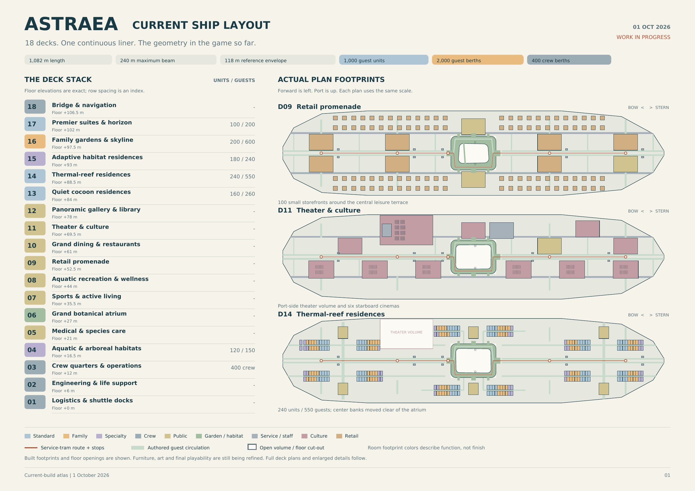

Plan figure 1. Current implemented footprint overview, exported from the live room registry and authored hull, atrium and transit contours on 1 October 2026. Bow is left and port is up. The export contains 1,462 registered spaces, including exactly 1,000 passenger units, 2,000 passenger berths and 400 crew berths. Colors indicate function, not finished materials. The companion current-layout atlas provides full deck plans and enlarged details; this master uses the overview for orientation. These plans show the implemented organization and do not certify finished furniture, collision or art quality.

## 5 Spatial design and transport

Status: CONFIRMED town scale, connected neighborhoods, separated service circulation and convenient transit. IMPLEMENTED deck travel and Townline. UNFINISHED complete normal-play spatial acceptance after the rebuild.

### Town structure

Astraea needs a hierarchy of places: ship, deck, district, street, threshold, room and activity cluster. Each district should have an arrival landmark, a clear route to its main activity, a quieter resting edge and a service approach. Long views establish orientation; shorter views offer something to discover. Repetition can make construction believable, but repeated blank modules do not make a town.

Public and service systems share a coherent vessel while serving different needs. Guests should read broad promenades, useful signs and welcoming thresholds. Custodians should discover stocks, cart-safe turns, back-of-house links and work access. A service shortcut is valuable when the player understands where it reconnects. It should not make the public ship feel like disconnected sets.

### Player movement and transit

Walking and cart guidance are the default local experience. The current service Townline provides five catchments along the length of the ship. The rebuilt positions are approximately z −432, −216, −72, 216 and 432 m. The starboard perimeter route avoids crossing the central hero tree. Signed platforms and a destination interaction make travel explicit. The player's cart visibly rides with restraints; stock must retain its identity and consumption state.

The directory's express-deck interface is the usable broad cross-deck system. It prepares the destination and collision before restoring control. Panoramic atrium capsules currently provide visual continuity and are not a claim of playable cabins servicing all decks. The theater gallery lift is a distinct physical platform with three stops, gates and actual cart-riding test evidence.

NPC transport is intentionally different in simulation detail. Guests walk to screened boarding vestibules, wait, travel for finite time and emerge at a destination. They do not board the player's physical tram, and passenger capacity on those abstract rides is not modeled. This distinction must remain clear in design discussion and player-facing claims.

### Purposeful volume and room form

CONFIRMED latest architectural requirement: large floor cut-outs and open areas must have a clear spatial purpose. Atrium voids, theater volume, overlooks, transit concourses and long sightlines should connect or reveal activities rather than leave unassigned emptiness. Every destination needs personality and a relationship to the hull and its neighbors.

Room footprints should arise from function and ship architecture. Curved lounges can follow observation edges; stepped dining areas can organize views and serving routes; nested habitats can create environmental thresholds; layered entries can separate a busy promenade from quiet rest. These are examples of the required design thinking, not a mandate to apply one decorative curve everywhere. The current registry atlas uses rectangular allocation envelopes; those rectangles do not establish the finished shape of the interiors. Actual room composition and use must be reviewed in the main game. The architectural target remains unapproved, and broad unassigned areas need deliberate purpose rather than cosmetic filling.

Acceptance requires a stated purpose for every large negative volume and a readable spatial identity for every destination. Capacity and clearance passes cannot approve architecture. Review room shape, arrival, focal activity, edges, light, materials and neighbor connections together, then demonstrate the result from ordinary first-person views.

### Doors and thresholds

PROPOSED production families are a deep public portal, a recessed private-suite door, a rounded habitat transition and a practical service door. They should share hardware and proportion while differing in outline, reveal, control and opening behavior. A colored rectangle around the same opening is insufficient. A door's open state must agree with collision; the cart must be able to turn on both sides.

Main routes require tested clearance for the real cart query shape and the largest supported guest envelopes. Avoid converting a geometric design target into a blanket claim about every doorway. Theater apertures and paths have specific tests; ordinary room paths need their own coverage. Rails, piers, trim, door leaves, stock cabinets and decorative planters all count as physical obstructions.

### Acceptance and dependencies

A player arriving normally must find supported floor before input resumes, see a destination rather than unloaded void, and retain every moved prop. Test ordinary arrivals as well as forced screenshot captures. Validate paths around atrium and theater openings, upper-gallery transitions, wet/dry entries and residential side lanes. A new structural revision invalidates the affected old route results. The known D03/D09 rebuild regressions pass their focused rechecks; complete normal-play traversal and current whole-ship acceptance remain open.

## 6 Cabins habitats and room design

Status: CONFIRMED varied accommodations with real beds and suitable facilities. IMPLEMENTED category assignment and support tags. PROPOSED detailed room kit and privacy behavior beyond the present build.

### A room is a small life support environment

Every accommodation needs a readable rest place, a place for belongings, an activity or sitting edge, environmental support and a believable entrance. A standard room, family room and specialty habitat should be recognizable without reading their labels. Beds must look usable from the player's eye level: frame, mattress or equivalent support, bedding or membrane, body clearance and an accessible approach.

Standard rooms hold two passengers. Family rooms hold three; this is a berth rule, not an assertion that every party is two adults and one child. Specialty rooms hold one or two. The six species do not change these counts. Baelins require aquatic homes and Mantelids require quiet cocoons. Existing eight habitat profiles describe room/rest types, not eight species. Premium finishes and environmental tags can overlap without adding berths.

### Proposed modular room kit

Use shared structural bays with distinct functional packages: ordinary layered bedding, low nesting platform, long curl berth, damp glazed cradle, branching perch, quiet cocoon and adjustable-light rest enclosure. Finishes should follow district identity but individual objects can reveal occupants. Repetition is acceptable in the shell; the dominant sleeping silhouette and adaptation should visibly differ.

Family rooms need three understandable rest places, shared storage, a common surface and enough circulation for a party. Child-oriented variants should use safe reachable objects and distinct scale cues without making every family room a nursery. Specialty rooms need an environmental centerpiece and a readable control or service point. Never imply exact pressure, gas or temperature simulation from a decorative enclosure.

Koblins have large families and no extraordinary needs. PROPOSED booking design links adjoining existing units and their actual berths into a larger household, preserving the 300 three-berth family units and total capacity. No new household-size distribution or automatic extra bed is approved. The relation between Mindo hardware and a rest fixture remains open; do not invent charging ports.

### Cleaning and privacy

PROPOSED cabin tasks occur by request, scheduled vacancy or an explicit knock-and-permission interaction. The player should not receive rewards for intruding on sleeping guests. A service indicator, polite response and clear accessible work area keep room care legible. A refused visit can return to dispatch without penalty. Guest possessions should be differentiated from removable litter; accidental touching should not silently destroy souvenirs.

Room-state persistence needs occupancy, service permission, placed belongings, outstanding incident IDs and environmental configuration. If personal possessions can be moved, the same stable-ID rules as the player's loose supplies apply. This is a design expansion; current room assignment and beds do not establish a complete privacy or housekeeping-request system.

### Acceptance

Review standard, family, damp, tall-body, low-body and quiet habitats at eye level with CRT on. Confirm enough floor space for the player, cart and working stance. A sleeping animation must rest on the actual support surface and not pass through furniture. At least one room from every functional family should have its own composition review before mass repetition. The present build's improved beds and shaped tidal capsule are partial asset successes; they do not approve all room architecture.

## 7 Ship systems and the service network

Status: CONFIRMED technical, logistics, medical and hospitality functions. IMPLEMENTED spatial representation and some ambient service behavior. PROPOSED detailed service interactions.

### Purpose

The enormous public ship is believable only if its support systems have a place. The player should see where towels, cleaning products, waste, food, repairs and colleagues come from. These systems provide routes and daily stories; they do not all require deep machine simulation. A functional fiction is sufficient when it stays consistent about what the player can affect.

| System | Spatial role | Proposed player contact | Simulation boundary |
|---|---|---|---|
| Power and propulsion | D02 fusion galleries and control areas | Clean access points, inspect approved service labels | No propulsion engineering simulator |
| Atmosphere and habitats | D02 plant and local accommodation support | Clear vents, replace a harmless labeled filter | Support tags rather than harmful gas simulation |
| Water and recovery | Plant, aquatic district and wet service returns | Dry exits, towel routes, surface care | No full fluid network required |
| Food and provisions | D01 stores, synthesis and D10 finishing galleys | Crumbs, trays, pantry and dirty-return stories | Guest meals already use reserved places |
| Laundry and sanitation | D01 processing and distributed care alcoves | Restock cloths and products, sort safe textiles | Abstract offscreen processing |
| Waste and recycling | Local bins and service transfer points | Sort ordinary harmless discarded objects | No hazardous-material handling loop |
| Medical and species care | D05 care, recovery and support | Quiet corridor and waiting-room care | No diagnosis or medical treatment gameplay |
| Communications and command | D18 bridge and operational nodes | Announcements, occasional authorized tasks | No required piloting or navigation system |

The detailed interactions in this table are proposals. A modeled machine or labeled department does not mean its maintenance mini-game exists.

### Care distribution

Local cupboards are important route anchors. A stock point should read as a service destination with enclosure, shelf depth, a visible bulb, legible product silhouettes and room to park. The player should be able to choose between using nearby stock and making a longer depot trip. Refill access is part of the navigation plan, not a vending machine placed wherever a test needs one.

The current kit replenishes locally when the cart is parked beside a cupboard. Travel and recovery cannot create product or refund used cleaner. An expanded stock network could track a small local capacity and replenishment schedule, but should not make an ordinary shift fail because a remote store happened to be empty.

### Acceptance

Every major public activity district has a reachable care approach and understandable support edge. Guest food routes and dirty returns should be distinguishable in the plan even when offscreen processing is abstract. Route tests must include the stock object and its shelf collision. A player can explain a facility's function from shape, sounds and context without needing a technical lore panel.

## 8 People and species design

Status: CONFIRMED replacement roster from 1 October 2026: Koblins, Mantelids, Humans, Baelins, Munkos and Mindos. These six replace the former roster. IMPLEMENTATION PENDING: the inspected runtime still has eight legacy rig and habitat indices; they are not the canonical species and cannot be renamed blindly.

### Canonical roster

| Species | Confirmed traits | Design consequence | Detail still open |
|---|---|---|---|
| Koblins | Small goblinoids; pesky, troublesome and the cheapest of the bunch. Large families; most are cruising space for the first time. No extraordinary needs | Preserve their character and first-cruise experience; support large households within the fixed berth ledger | Population share, household size distribution and any precise meaning in prices or purchasing behavior |
| Mantelids | Sophisticated insectoids who largely keep to themselves and enjoy the quiet of their cocoons. They make little mess except for an extremely gruesome molting process | Quiet cocoon accommodation and restrained social preference; molting must retain its confirmed gruesome character | Molt frequency, physical residue, depiction, privacy, cleanup method and comfort options |
| Humans | As expected | Humans are explicitly part of the population | No additional exceptional biology, cultural detail or demographic share is established |
| Baelins | Beluga-like humanoids with soft gelatinous cartilage instead of bones. Produce gooey, oily trails requiring special cleaners. Enjoy baths and require aquatic accommodations | Aquatic home compatibility is mandatory; bath preference and distinct cleaner compatibility must be designed | Water parameters, body dimensions, trail rate, cleaner name, cost and exact treatment |
| Munkos | Odd four-armed humanoids with an extreme appetite; respectful enough | Four-arm support and animation; adequate food service for their appetite without making them rude | Food quantity, meal cadence, diet, body dimensions and demographic share |
| Mindos | Artificially intelligent species on synthetic hardware, considered robots by most; recently received rights and acknowledgment as sentient | Treat them as sentient guests and colleagues; their recent legal and social recognition belongs to the setting | Power, charging, ports, diet, sleep/rest model, maintenance and hardware variation |

These are the user's confirmed traits. No equal population split, species-exclusive job, new currency, dietary formula or quantitative biological parameter is implied. The exact user-authored roster is preserved in Species_Canon_User.txt. The current phase remains the fully realized ship and autonomous life, with storyline and exact gameplay detail deferred.

### Bodies habitats and implementation

Species identity must be separate from a render rig, body envelope, room class and environmental support profile. The existing eight habitat families can remain physical room or rest types; they do not imply eight species. A quiet cocoon or aquatic habitat can support a confirmed need once its actual function and compatibility are verified. Old profile indices are legacy implementation identifiers, not an approved mapping to the six new species.

Preserve 1,000 passenger units, 2,000 passenger berths and 400 separate crew berths including the player. No species distribution is fixed. Baelins must receive genuinely aquatic accommodation rather than a generic room with a damp label. Mantelids need quiet cocoons. Koblins have no extraordinary accommodation needs; their larger households need relationship and booking design without silently increasing a three-berth room's capacity.

The migration must preserve persistent person IDs, home and bed ownership, party links, current activity, incident provenance, claims and saves. Old rigs and historical screenshots are development evidence only. A six-name menu or changed label is insufficient: bodies, supported poses, needs, reservations and actual rooms must agree. Save conversion and any redistribution remain proposed until implemented and checked.

### Individual identity and expression

Spirited Away remains an influence for encountering particular beings sharing a place. All species assets and culture are original. R.E.P.O. informs awkward physical objects rather than guest appearance. The new roster supersedes species suggestions in earlier concept images.

Retain the specified species traits while giving individuals names, interests, relationships and differing reactions. Small Koblins are not automatically children. Munkos are not made hostile by appetite. Mantelid privacy and low ordinary mess should coexist with their exceptional molt. Mindos must not be written as unrecognized objects merely because many people call them robots. No charging-port design or synthetic diet is canon yet.

### Acceptance

All six species must be distinguishable in the original low-poly CRT style, including Humans. Verify Baelin aquatic home assignment and special-cleaner need, Mantelid quiet cocoon use and gruesome molt specification, Munko four-arm clearance and appetite service, Koblin household continuity, and Mindo identity and rights language. Numeric parameters remain marked proposed. Observe real routes, rest, meals or the agreed equivalent, leisure, work and save/load; legacy eight-rig tests do not certify the new roster.

## 9 Guest needs and daily life

Status: IMPLEMENTED persistent needs, schedules, reservations, travel and ambient activities. VERIFIED behavior in specified model and integrated checks. UNFINISHED a fully polished day of visible guest performance.

### Population model

All 2,000 passengers have persistent identities and real assigned bed anchors. Nearby bodies are a visual projection of those records, not freshly rolled crowds. Offscreen guests continue as bounded data. The player can leave a district and return to the same people with changed needs, location and history rather than a reset set of extras.

The legacy model uses shared hunger, fatigue, social need and comfort values. These are implementation variables, not confirmed biology for all six species. Munkos have an extreme appetite, but its quantity and cadence are undecided; Mindos have no established biological diet, charging schedule or sleep requirement. Migration must define suitable needs without inferring them from the old timetable.

Hunger, fatigue, social need and comfort persist in the current prototype. Meals reduce hunger only after arrival at a reserved real place and actual service progress. Sleep belongs at the assigned berth. Rest uses entry and recovery thresholds to avoid a guest repeatedly commuting away and immediately deciding to sleep again. A cleaning completion can modestly improve the source guest's comfort.

### Schedule and commitment

The schedule targets sleep, three meal windows, a favored amenity, possible social visits, quiet rest and finite travel. Current regression evidence proves eating and sleeping at least once plus its dinner assertion; it does not prove that all three daily meal windows complete for every passenger. Individual windows are staggered, with a small suite-mate offset. A destination commitment stores activity, room, deck, target, route and travel phase. New schedule intent cannot turn an old route into a magically completed meal or bed visit.

Missing routes should result in a recoverable waiting state, never movement through a wall. Meal intent remains pending if the nominal time window closes while the guest is traveling. Current route speed is 3.2 m per simulated minute; the 0.6 simulated minute per real second clock gives approximately 1.92 m/s. These are implementation values to be evaluated for pacing, not binding design constants.

### Capacity and activity contracts

Dining uses 2,200 physically modeled places across ten venues. Each reservation has one owner and is retained during travel and service. Theater chairs cannot count as food capacity. Current completed service lasts 18 simulated minutes before releasing the seat. If a venue is full, the guest waits and retries instead of being credited with an invisible meal.

Shopping has browse, inspect, purchase and parcel substates. Purchase history and carried parcels persist, and stores colleagues can resolve bounded restock requests. This is ambient commerce with no effect on the player's wallet. Aquatic visits use actual water-height anchors, a dry entry and exit, and a paddling pose. Damp cleaning work occurs at the dry exit rather than beneath the water. Theater and cinema visitors watch from safe viewing anchors; a 3,400-chair registry does not imply a fully seated audience scheduler.

The new species contract also requires Mantelid quiet-cocoon use, Baelin aquatic home eligibility and bath preference, and household continuity for large Koblin families. These traits are confirmed; the associated runtime migration and exact parameters are unverified.

### Social continuity

Conversations require two available guests in the same room and deck within range. Both share an episode and reciprocal partner IDs. Their needs improve through the episode, and each retains a named last partner. This provides a truthful foundation for later relationships. A scheduled social visit is an opportunity, not a guarantee that every passenger must complete a conversation every day.

### Acceptance

A full-day cohort test must show every guest can reach food and assigned sleep, with no duplicate dining reservations, invalid homes or out-of-bounds needs. Observe representative journeys in normal play as well. Verify that a label saying eating, sleeping or swimming corresponds to an appropriate pose and support surface. Large time skips use explicit catch-up rather than pretending one ordinary tick can safely resolve many hours.

## 10 Families children and social relationships

Status: CONFIRMED families and children belong in the master design scope. IMPLEMENTED accommodation parties and compatible shared-room assignment. PROPOSED child-specific behavior, guardianship, ages and relationship systems.

### Family design

A family is an authored or generated relationship group, not simply every three occupants in a family cabin. Parties may include relatives, guardians, friends or other original social structures once the fiction is defined. The berth ledger remains unchanged: a child occupies an actual assigned berth; day facilities do not create extra overnight passengers.

Koblins canonically travel in large families, with most new to space cruising. Household links may span several booked units; using adjoining existing three-berth units is a proposal, not extra capacity. Their small bodies do not establish age. Family structures, children and guardians for the other species remain open, and Mindo personhood does not imply a particular family structure.

The current party model shares accommodation identity and compatible environmental support. It does not establish a complete simulation of parents, children, supervision or age-specific needs. Do not label a small species member as a child because of size. Age presentation needs deliberate animation, writing and prop choices distinct from morphology.

### Proposed family behavior

Give a party a shared plan with flexible individual actions: a meal rendezvous, a play period, a rest window and a known regroup point. Adults and children can have different interests while remaining traceably linked. Separation should produce an ordinary regroup behavior, not a distress emergency that makes the cozy player responsible for safeguarding everyone.

Children can create distinctive harmless traces such as craft scraps, chalk-like play marks, soft confetti or spilled juice. These should follow actual activities. Include tidy and helpful children too: one may point out a dropped object, thank the player or carefully return a toy. Avoid designing children solely as mess generators.

### Play and interaction boundaries

A family activity area needs good sightlines, resting places for accompanying adults, accessible fixtures, age-readable objects and a service route. Current registered family functions are a spatial foundation, not proof that supervised play is implemented. Dialogue should be kind, brief and age-appropriate. Quests should never ask the player to conceal a child's whereabouts, invade privacy or administer medical care.

PROPOSED relationship state records recurring greetings, favors, familiarity and the last meaningful event. Use small named memories instead of a universal friendship bar over every head. Relationships can affect optional conversation and personal stories, while access to ordinary facilities remains inclusive.

### Acceptance

A test family stays consistently assigned through travel, save and overnight progression. Regroup behavior is deterministic and recoverable. A child-focused task has a clear adult or activity context and an optional decline. No species is mapped wholesale to an age role, and no family composition is silently treated as the default for every cabin. Detailed ages, party distribution and the number of authored family stories remain open decisions.

## 11 Staff and the custodial team

Status: CONFIRMED separate crew life and a shared custodial home base. IMPLEMENTED 400-person roster including the player. PROPOSED named relationship arcs and richer visible task performance.

### Colleagues have lives

Astraea's crew is not an invisible cleanup service. The current roster has permanent home berths, roles and staggered work, break and sleep routines. The autonomous population is 399; the player entry mirrors their place in the crew without generating an AI duplicate. Roles include custodial, engineering, galley, care, gardening, transit, hospitality and stores.

The six-species canon applies to people aboard, including any represented crew. No species-to-job allocation or staff demographic split is approved. Baelin crew require aquatic-compatible homes just as passengers do; Mindo colleagues are sentient people with recently recognized rights. The legacy crew setup needs this migration and verification.

The shared breakroom should express how people care for one another under an indifferent employer. Cold institutional light is confirmed, but cups, repaired furniture, notices and personal touches can give the room humanity. Upgrades should build on an already meaningful shared place rather than turn an empty box into the first evidence that colleagues exist.

### Dispatch and responsibility

Mina is the current headset persona and text-dispatch label. Recorded speech is not implemented. Treat the name and full characterization as provisional until the cast is approved. The functional role is a calm colleague who makes a manageable suggestion, acknowledges progress and helps the player recover. They should not be an all-seeing supervisor commenting on every movement.

Background staff resolve unattended incidents after grace periods. A specific colleague is not currently pathing to every offscreen spill. Player-claimed and partially cleaned work remains protected. The aggregate service model is appropriate while the visible crew routines make the ship feel staffed; future visible task animations can connect those layers without requiring 399 fully physical agents.

### Proposed recurring cast roles

Start with a small group: the dispatch colleague, a stores worker, a gardener, a galley worker and a custodian sharing the breakroom. Give each a place, schedule, interest and one evolving concern. Detailed names, backgrounds and arcs are proposals. Let conversations include hobbies, food and daily pleasures rather than only corporate grievance.

### Acceptance

Crew assignments remain separate from passengers, and the player never appears as a second autonomous body. Work, break and rest totals survive a save. A visitor to D03 can identify a shared room, private home, depot and route to duty. At least one background service action is understandable without a debug counter. Final staff relationship content must have authored lines, conditions and repetition limits rather than generic barks alone.

## 12 Shift planning and gentle dispatch

Status: CONFIRMED manageable daily work and calm headset guidance. IMPLEMENTED nearby incident suggestions, voluntary clock-out and background care. PROPOSED richer assignment planning.

### A manageable responsibility

A shift should give the player a place to begin and permission to be finished. Dispatch proposes a nearby, reachable incident with a clear room and reason. The player may accept, postpone or wander. A suggested job should not silently become a timed obligation. The living ship can create more activity than the player handles because colleagues cover the rest.

Current cleaning work is bounded: no more than 96 unresolved ship incidents and ten promoted local incidents. Local promotion is rate-limited, and unseen work can be resolved by background crew. These are protective implementation limits, not a user-facing quota. The player should experience a plausible flow of work rather than watch the system manufacture mess whenever they finish the previous one.

### Proposed assignment structure

An assignment can group one to three nearby incidents around a place: a morning breakfast edge, an afternoon family commons or a quiet theater turnaround. The assignment stores a stable ID, source events, location, guidance line, claim state and completion state. Grouping must not duplicate individual cleanup credit or lock the player into an entire deck.

A good dispatch line states where, what and why in a sentence. Route assistance should prioritize service access and local stock, while leaving exploration optional. The player can return a job without punishment if a route is temporarily unavailable. A dispatch queue must never insist on cleaning a guest who is still swimming or on reaching a residue beneath a chair collider.

### Shift settlement

The current build pays a predictable base plus a bounded care bonus when the player clocks out. Payment is keyed by shift ID. A receipt should separate base, optional bonus, wallet change and any subsequent transfer. The next shift advances guest and crew life through a visible transition, preserving assignments, claims, money and upgrades. Escape must not accidentally interrupt that transition and restart ordinary simulation.

PROPOSED shift identity can come from a short colleague note, a changing venue program and a few optional story opportunities rather than escalating quotas. Some days can be quiet. A comfortable routine is useful content when the people and place are specific.

### Acceptance

A new incident includes valid source, destination, reachable stance and unique identity. A partial claim cannot be removed by crew while the player is working elsewhere. Declining an optional task does not withhold base pay. Clock-out, reload and repeated button presses cannot pay twice. Ordinary menu clicks do not trigger a world interaction on the first resumed frame.

## 13 Cleaning diversity and incident design

Status: CONFIRMED diverse care, Baelin gooey oily trails needing special cleaners, and extremely gruesome Mantelid molting. The latter supersedes the earlier harmless-only residue restriction. IMPLEMENTED legacy finite-cloth wiping; species-specific incidents and treatments remain to be designed and verified.

### The current action

The player parks the cart, has hands free, loads a cloth from a full bottle physically on the tray, aims at a reachable mess and holds the interaction. A physics ray and range/cone checks determine whether the target is valid. Cloth charge drains according to removed dirt; the incident visibly shrinks; completion resolves the world object and model event once.

This is a solid base but not yet a diverse tool system. Different residue names or colors should not be mistaken for mechanically different cleaning. The next expansion should add a few clearly distinct gestures and material responses before multiplying the catalog.

### Confirmed species residue

Baelin trails are gooey and oily and require special cleaners. A renamed universal bottle does not establish cleaner compatibility. Mantelids ordinarily make little mess, but their molting is extremely gruesome. Do not reduce the confirmed molt to innocuous glitter or generic dust. Its depiction, timing, residue, privacy, care procedure and presentation options remain undecided. Neither trait establishes an infection system, punitive contamination chain or medical task.

### Proposed incident families

| Incident family | Plausible source | Treatment idea | Visible completion cue |
|---|---|---|---|
| Crumbs and dry flecks | A completed meal or snack | Gather or brush, then a short wipe | Loose pieces gather and disappear into the tool |
| Tea or juice spill | Dining or a social table | Absorb and wipe the edge | Wet sheen contracts before the surface clears |
| Damp tracks | A guest leaving a pool or bath | Broad absorbent pass | Track sequence fades in travel order |
| Soft botanical litter | Garden activity or a shed leaf | Pick up or gentle sweep | Individual leaves leave the floor |
| Glittering harmless dust | A particular guest activity | Dust with a visible soft stroke | Sparkle density falls without visual noise |
| Smudged glass | Looking out, touching a display | Controlled glass wipe | A clean patch expands across the reflection |
| Craft scraps | A supervised family activity | Collect and sort safe scraps | Table and floor regain their clear shape |
| Sticky sweet residue | A snack or shop sample | Apply gentle lift-off product, wait briefly, wipe | Surface loosens, then clears |
| Soft textile lint | Lounge or rest activity | Brush a small upholstered area | Lint detaches without damaging cloth |
| Misplaced ordinary litter | A completed visit | Pick up and place in the correct bin | Object remains accounted for until disposed |

All rows are proposed additional content families, not ten implemented tools. They coexist with the confirmed Baelin trails and extremely gruesome Mantelid molt. Earlier blanket restrictions on gruesome species residue no longer apply. Detailed treatment, safety fiction and tone need design; dangerous chemistry, infection and punitive contamination are not established by the new roster.

### Incident data contract

Every event needs a unique ID, source guest or approved world activity, source room/deck, source time, source position, reachable residue position, material family, amount, treatment stage, claim owner and completion state. Source and residue positions can differ when the actual meal seat is under furniture. Preserve provenance rather than moving the fictional cause to wherever a decal happens to fit.

Variation should follow source, material, activity and individual behavior while preserving the confirmed traits: Mantelids are low-mess except for molting, and Baelins produce characteristic oily trails. Koblin troublemaking does not define an additional biological residue, nor does Munko appetite automatically imply rude table behavior. Rewards and precise mess rates remain design decisions; no species-based wage formula is approved.

### Satisfaction and failure handling

Each action needs an immediate start cue, readable progress, a distinct finish and a short residue-free pause. Do not require pixel hunting for the last invisible percent. A small completion tolerance can be explicit and consistent. If a tool is unsuitable, explain it without damaging the guest's property. If a target becomes unreachable, repair its anchor or release it safely rather than strand the shift.

Acceptance requires several genuinely different cleaning rhythms, clear progress at low resolution, no infinite residue regeneration, no duplicate rewards and stable partial-state saves. Observe naturally generated incidents; developer-spawned decals alone do not prove causal guest work.

## 14 Tools products and the physical cart

Status: CONFIRMED physical comedy, loose supplies and distributed restocking. IMPLEMENTED spring-guided cart, bottles, grabbing and tossing. PROPOSED a broader tool and product catalog.

### Cart behavior

The current cart is an 18 kg rigid body with a low center of mass, collision tray, wheels and a damped handle spring. It has real steering lag. The three 0.45 kg bottles are separate rigid bodies. They can wobble, fall, roll, be held and be tossed. The desired feeling is slightly awkward and funny while remaining dependable enough for a relaxed game.

Guidance should preserve a player's sense of the handle and turning radius. A cart should not behave like a camera-attached inventory box. At the same time, repeated snagging on decorative trim is a level defect, not comedy. Recovery is an accessibility and reliability feature; it must conserve product and not solve movement by duplicating props.

### Supply rules

Only a full bottle physically on the tray and not held is available for loading the cloth. Loading consumes that bottle's fill. Restocking requires a parked cart beside a real care cupboard. Deck travel, scripted tram restraint, save/load and recovery must preserve fill and stable identities. A nearby bottle on the floor is not silently counted as inventory.

The legacy prototype uses one universal cleaning product and a cloth. Baelin trails now canonically require special cleaners; their formula, product name, price, dose and interaction remain unapproved. Mantelid molt cleanup is also unspecified. Preserve existing bottle identities and consumption while designing these distinct treatments.

New products should add understandable choices without turning the game into chemistry homework. Labels need readable silhouette, symbol and text so color is not the sole distinction. Decorative packaging must remain legible in the retro output.

### Proposed kit expansion

| Tool or product | Job role | Physical handling | Design gate |
|---|---|---|---|
| All surface cleaner and cloth | Reliable default care | Existing bottle and hand cloth | Baseline must remain useful throughout the game |
| Absorbent pad or small mop | Larger wet tracks | Larger head and bucket or cartridge | Different stroke and convincing wet reduction |
| Soft brush and pan | Crumbs, lint and leaves | Two simple shaped objects | Collection remains easy to read and retrieve |
| Glass cloth | Windows and display smudges | Distinct texture and holder | No requirement for exact pixel-perfect tracing |
| Gentle lift off product | Sticky sweet residue | Labeled small bottle | Brief dwell gives choice without tedious waiting |
| Small pickup tong | Ordinary awkward litter | One-handed hinged tool | Grip is forgiving and safe for all supported objects |

This is a proposed production order, not a requirement to build everything at once. Product brands and names remain open. The same original SunCorp packaging family can include mundane institutional cleaner and a few personal upgrades without copying real brands.

### Acceptance

Test loading while bottles are held, falling, empty, off the tray and on the tray edge. Confirm the result is physically understandable and cannot produce free cleaner. Drive a full cart through a door, into a stock alcove, onto the actual theater platform and through a transit handoff. A save with one fallen moving bottle must restore its transform, velocity and fill without creating a second copy.

## 15 Money wages and sending funds home

Status: CONFIRMED fictional wages, bank, money home and domestic tradeoffs. IMPLEMENTED values below. PROPOSED long-term tuning and any future household obligations.

### Current economy baseline

| Item | Current implementation |
|---|---|
| Currency label | cr |
| Starting wallet bank and sent home | 0 each |
| Base wage per settled shift | 120 cr |
| Optional care bonus | 5 cr per job up to 40 cr |
| Maximum shift wage | 160 cr |
| Bonus cap reached | 8 jobs |
| Deposit withdrawal and remittance buttons | 40 cr per press |
| Bedroom levels | 75 then 110 then 150 cr |
| Breakroom levels | 75 then 110 then 150 cr |
| Gear levels | 75 then 110 then 150 cr |
| Cost per complete track | 335 cr |
| Cost of all three tracks | 1,005 cr |

These values are current code constants, not an approved final economy. Internal transfer methods accept positive affordable integer amounts; the menu currently exposes fixed increments. Deposits move wallet to bank; withdrawals reverse that move. Sending home debits bank and increases a separate cumulative sent-home total. No real account or external transfer is involved.

### Conservation and player trust

Every transaction should have a unique identity and a before/after balance. A shift pays once even if settlement is invoked repeatedly or a save is reloaded. Insufficient funds leave every balance unchanged. Upgrade purchases are sequential and bounded by the maximum level. Money sent home is not simultaneously spendable aboard. A visible receipt should communicate these rules without requiring arithmetic from the player.

The current implementation has no rent, recurring bill, debt, interest, fine or collection system. Bills back home are narrative motivation. Introducing mandatory expenses would materially change the gentle loop and requires a separate decision. Do not retrofit pressure through surprise deductions or punish exploration by reducing the base wage.

### Balance implications

At current prices, one base shift can buy a first-tier upgrade. Buying all tracks while sending nothing home takes at least seven maximum-bonus shifts or nine base-wage shifts. This is simple arithmetic, not a prediction of actual player pacing. The short horizon is useful for exercising systems but does not yet establish a satisfying long career.

PROPOSED balancing starts from choices per shift rather than arbitrary inflation. A small comfort should be reachable after a normal shift, a larger shared improvement should invite saving, and sending something home should leave room for personal care over several days. Test several play styles: minimal work, eight-job bonus, exploration-heavy, home-focused and decor-focused. Avoid tuning solely for a player who cleans efficiently without detours.

### Acceptance

Run conservation tests across deposit, withdrawal, remittance, upgrade, repeated clock-out and reload. Check negative, zero, unaffordable and repeated requests. Save during a completed-but-not-yet-dismissed receipt and ensure the next load cannot repay it. Player-facing text must distinguish lifetime sent-home from current bank balance. Final price changes require a migration or a clear new-career policy.

## 16 Shopping decoration and domestic spaces

Status: CONFIRMED shops and personal/shared improvements. IMPLEMENTED ambient guest shopping and fixed upgrade bundles. PROPOSED player retail checkout, inventory and free placement.

### Two different shopping systems

Astraea has 100 addressed storefronts. Guests browse, inspect, nominally purchase goods, carry parcels and return home. Stores staff receive bounded restock work. Current goods such as a wrapped keepsake or useful little gift are ambient metadata; they are not a stocked player catalog with prices and checkout. The player's actual purchases are the three fixed upgrade tracks.

Current repeated storefront names include Little Orbit, Thread House, Pocket Garden, The Parcel Room, Soft Landing, Moon Paper, Pebble and Reed, Tide Goods, Copper Buttons and Kind Curios. Unique R001 to R100 addresses prevent repeated brand names from becoming ambiguous destinations. These names are implementation content and remain open to final writing review.

### Current domestic rewards

Bedroom level one adds a living plant. Level two adds a rug and bedding or pillow detail. Level three adds a warm lamp and a displayed message from home. Breakroom progression adds tea and cups, shared seating and cushions, then a reading shelf and books. Gear modifies cleaning speed and cart damping, with a visible tray detail from the first level. Levels zero through three use 4.60, 3.95, 3.30 and 2.65 seconds per full dirt unit, and cart angular damping of 2.40, 2.65, 2.90 and 3.15. Typical incidents contain less than one dirt unit.

These are cumulative bundles. They do not yet provide a free-placement editor, separate furniture inventory, color customization or a complete catalog. All-tier visual acceptance is still required. A successful deduction and level number cannot substitute for an obvious, useful change in the space.

### Proposed decoration model

Begin with authored placement sockets in the private cabin and shared breakroom. They protect door clearance and composition while giving a choice of lamp, textile, plant, shelf item or small wall object. A placement preview should show valid position, rotation and any blocked route. The player should be able to undo or return an item without losing it.

A later free-placement mode can be considered once stable IDs, collision rules and save migration are reliable. Every owned object needs catalog ID, instance ID, ownership, location, transform and state. Placed decor must not disappear when a deck unloads. Shared purchases should feel communal; colleague reactions can recognize an improvement without turning them into votes on every furnishing.

### Proposed catalog organization

Use a few meaningful stores rather than 100 fully unique commercial inventories. Group goods into comfort, shared hospitality, keepsakes, plants and practical kit. Each product needs price, thumbnail or inspectable model, dimensions, placement type, effect, asset dependency and description. Cosmetic choices should not require grinding unrelated activities, and shopping must never introduce real-money currency.

Acceptance requires a complete purchase-to-placement-to-reload loop. Cancelling checkout leaves money unchanged. Bought objects cannot duplicate through undo or travel. At least one small room remains usable with every maximum upgrade installed. Final prices and catalog depth are open decisions after the core economy review.

## 17 Progression and unlocks

Status: CONFIRMED persistent wages and improving home shared space and equipment. IMPLEMENTED three sequential upgrade tracks. PROPOSED district familiarity, narrative unlocks and longer career pacing.

### Progression should deepen familiarity

Astraea's size is an invitation to learn, not a reason to lock every deck behind a level number. The current directory exposes broad travel. A proposed guided introduction can recommend a small home district first without pretending the rest of the ship does not exist. Functional access restrictions should have a believable operational reason and a clear path to permission.

Growth can come from knowing where stock is, recognizing a guest's routine, selecting a better route and owning a comfortable cabin. These forms of mastery support the cozy role more directly than an endlessly rising productivity stat. Tool upgrades should improve forgiveness or convenience as well as speed; do not tune the starting cart to be unpleasant simply to sell a fix.

### Proposed progression layers

- Personal capability: a more stable handle, clearer product organization or a broader cleaning head
- Domestic comfort: a place to sit, better bedding, a preferred lamp or a small collection
- Shared care: a breakroom tea station, a repaired seat, a shelf or a communal plant
- Familiarity: remembered names, optional stories and useful local knowledge
- Work variety: a new safe treatment or facility-specific task after a short introduction

Each unlock should have an understandable trigger and a tangible result. Avoid overlapping currencies, daily login pressure and random paid rewards. No reputation currency or skill tree is currently approved.

### Proposed milestone cadence

Use the first few shifts to establish work, navigation and wage choices. Introduce one new treatment only after the player understands its default alternative. Place relationship changes between work moments rather than queueing several long conversations at settlement. Later content should combine familiar tools in new places before adding another control scheme.

Acceptance asks whether a player notices the change without checking a menu. Gear should not trivialize all interactions, and cosmetics should not reduce practical space. Save/load must preserve unlock state and prerequisites. A designer should be able to trace every proposed unlock to its asset, interaction, tutorial and test requirement.

## 18 Quests and narrative content

Status: DEFERRED to a later phase. The depth and details of the exact questline are not established. The following framework and examples are PROPOSED discussion material; storyline implementation follows the fully realized ship and properly functioning staff and guest life. Current headset chores and greetings are prototype behavior, not an approved quest framework.

### Quest contract

A quest has an ID, giver or source, activation condition, location, objectives, optional steps, dialogue states, reward rule, completion record and recovery path. It must behave predictably when the player leaves, saves, finishes a step out of order or returns next shift. A quest should use existing places and systems wherever possible rather than generate a detached mini-level.

Separate routine care requests, short personal favors and multi-shift stories. Routine work should remain available without narrative obligations. A story reward can be a relationship beat, a keepsake or access to a new conversation; money must not become an incentive to manufacture mess or exploit repeated quest triggers.

### Proposed quest briefs

| Quest | Setup and core action | Meaningful result | Dependencies |
|---|---|---|---|
| The Borrowed Cup | A colleague asks for a familiar cup found along a normal service route | A small breakroom story and returned object | Object identity, ownership and give-back interaction |
| A Quiet Window | A guest requests a clean observation pane before a favorite view | A shared quiet moment after visible glass care | Glass treatment, timed but forgiving event window |
| Paper Constellations | A supervised family activity leaves safe craft scraps | A child can offer an original paper keepsake | Family context, pickup/sort, dialogue and item ownership |
| The Damp Shortcut | A pool-exit trail repeatedly reaches the wrong corridor | Player cleans it and helps place a practical mat | Causal water exits, permitted placement, persistent fix |
| A Seat That Fits | A guest asks for a better rest or dining arrangement | Appropriate support and a specific thank-you | Accommodation metadata, movable fixture or authored alternate |
| Before the Last Show | Theater staff prepare an aisle and a viewing place | Player can stay for the original light performance | Auditorium routes, care anchors, event state |
| The Breakroom Shelf | Colleagues contribute objects after a shared upgrade | The room changes across several shifts | Upgrade state, authored cast and persistent props |
| A Brighter Future | A new SunCorp notice contrasts with a small staff shortage | Optional conversation and corporate context | Notice state, writing approval and restrained lore |

All names, plots and rewards here are proposals. They do not establish the player's family or commit the game to a particular ending.

### Quest quality rules

A task must have a clear reason to involve a custodian. Avoid requests that make the player an untrained doctor, engineer or security officer. Optional timers should create atmosphere and an alternate outcome rather than sudden failure or lost wages. If a guest changes location, the quest tracker should follow their identity, not a stale coordinate. A family request should retain the appropriate guardian or activity context.

Acceptance requires idempotent objectives and rewards, graceful postponement, save/load at every state transition and a visible conclusion. At least one quest should be fully played in the integrated ship before authoring a large campaign list. Production planning must count dialogue, props, animation, sound, conditions and recovery copy as part of each quest's cost.

## 19 Recreation and mini games

Status: CONFIRMED a varied vacation liner with things to do beyond cleaning. IMPLEMENTED physical basketball toys and ambient leisure. PROPOSED scored or structured mini games.

### Existing recreation

The main build includes sports areas, two physical basketballs associated with courts, aquatic facilities, shops, libraries, observation spaces, a large theater and six cinemas. A player can grab and shoot a ball, but scoring, teams and full sports rules are not implemented. Guest swimming follows water-level anchors; player swimming and a fluid-physics game are not established.

The theater presents the original light program A Thousand Small Worlds. Cinema programs are The Tide Remembers, A Map of Small Suns, The Patient Orchard, Letters from the Quiet Moon, The Last Lantern Home and Clouds Borrow the Sea. These are real-time abstract visual shorts, not feature-length films or licensed content. Modeled speakers do not imply completed film soundtracks.

### Proposed mini game candidates

| Activity | Interaction | Reward philosophy | Priority |
|---|---|---|---|
| Casual hoop challenge | Throw the existing physical ball toward a forgiving target | A personal best or friendly reaction | First candidate because physics already exists |
| Parcel sorting | Match clear symbol and destination on a small shelf | A short staff favor, not mandatory income | Second candidate if handling remains pleasant |
| Botanical arrangement | Place a few original plants in authored sockets | A changed garden corner or keepsake | Good link to decoration and care |
| Constellation viewer | Align a simple optical frame at an observation point | Lore, a postcard or quiet discovery | Low-pressure alternative to scoring |
| Cooperative tabletop toy | Take turns with a guest in a short pattern game | Familiarity and a conversation beat | Later after interaction states are robust |

These are candidates, not promised scope. Prefer one polished activity over a collection of shallow menu games. Every activity needs an exit at any time and must pause or save without trapping the player's cart or consuming supplies.

### Acceptance

A recreation loop should be enjoyable without currency rewards. It must be readable at low resolution, accommodate input preferences and return the player to their previous work state. Physics toys need recovery that preserves identity. Scoring should not rely on a ball passing through a nonphysical visual target. Theater viewing requires an actual clear sightline from normal arrival, not only a staged capture angle.

## 20 Dialogue and communication

Status: IMPLEMENTED short contextual greetings and text dispatch. UNFINISHED branching conversations, authored relationship arcs and recorded voice. PROPOSED dialogue framework and samples.

### Dialogue layers

Use separate channels for a nearby guest greeting, a colleague conversation, headset dispatch, SunCorp public address and home correspondence. Their frequency, placement and sound should differ. The player should always know who is speaking and whether a response is expected. A chime accompanying text is not voice acting.

Current guest greetings can reference activity, recent care, a conversation partner, a parcel or a show. This is a useful factual basis. It should not be described as free-form AI conversation or a full relationship system. A line can mention a known event only when that event actually occurred in the guest's persistent state.

### Proposed writing rules

Give speakers distinct interests and rhythm; keep work barks short and longer conversations optional. Preserve Koblin first-cruise experience, Mantelid reserve, Baelin bath preference and respectful Munko appetite alongside individual voices and Humans. Mindos have recently received rights and recognition as sentient; calling them robots does not revoke that canon. Do not invent their diet or charging behavior, a uniform species accent, legal history or a link between their rights and SunCorp. Detailed stories remain deferred.

Store lines by stable ID with speaker, context, priority, prerequisites, cooldown, repeat policy, localization key and any state change. High-priority route or supply help should not be hidden by ambient chatter. Repeated thank-yous should taper. A guest whose incident was handled by crew should not automatically thank the player.

### Proposed sample lines

- Dispatch: “There’s a small tea spill by the east window. The cupboard beside it is stocked.”
- After care: “Thank you. I can see the little moons in the glass again.”
- A hurried guest: “I thought the theater was one floor down. It is quite a ship.”
- A stores colleague: “The short bottles fit the top shelf. I learned that the loud way.”
- A child during a supervised craft activity: “That one is our ship. I made the windows too big.”
- SunCorp public address: “A brighter tomorrow begins with the care we share today.”

These are original draft examples for tone, not approved final dialogue. Home-message samples should wait until the recipient relationship is established.

### Acceptance

Text wraps in the smallest supported window, remains crisp above CRT and can be reviewed long enough to read. Subtitles identify speakers and meaningful non-speech sounds when implemented. Interrupting, re-entering, saving and changing decks cannot duplicate a dialogue reward. Every conditional line is checked against the actual state it claims. Localization must allow longer strings without covering interaction targets.

## 21 Art direction and architectural craft

Status: CONFIRMED retro low-resolution world, controlled dithering and CRT, charming original modeled forms, fixture-driven light, warm guests and cold institutional staff areas. UNFINISHED overall art approval.

### Visual target

The target is a carefully modeled, materially rich early-2000s-style world with readable modern interface text. Creature Kitchen informs close-scale low-resolution material charm and visible local bulbs. Prey informs architectural hierarchy, layered thresholds and deliberate place-making. The latest direction explicitly keeps all geometry, materials and rendering in the project’s low-poly CRT-dithered style; the blueprints and diorama supply composition and hierarchy, not a photorealistic finish target. The supplied inhabited-atrium image informs tree structure, shaped terraces, water, glass lift landmarks and useful social clusters. Logan’s Run is a further confirmed influence for inhabited multi-level circulation, visible movement between balconies and destinations, and gatherings around focal spaces. None is a request to copy assets, characters, a film plot or branded staging.

The four additional interior references in chapter 30 reinforce whole-composition coherence: useful human-scale density, material continuity, clear focal purpose, integrated furnishings and believable routes. These are lessons to translate into original low-poly CRT-dithered spaces. They supply composition guidance rather than production assets; later Composition04 approval applies to its direction and further refinement.

Astraea needs both monumental scale and touchable detail. A wide atrium should show a large open volume, a recognizable tree and destinations where people seem comfortable. A close work corner should show a rounded cupboard, shaped containers, patterned material, shelf depth and light falling from a visible source. A beautiful cutaway cannot substitute for a useful first-person composition.

### Architecture

Model primary form before adding texture: thick curved terraces, fluted piers, nested portals, weighted plinths, shaped balustrades and offset bridges. Door reveals should have depth. Stairs and ramps should have clear support and edge light. Avoid broad empty rectangular wall fields, identical thin rings and decorative strips used to disguise unfinished geometry.

The botanical hero tree needs a credible trunk-to-bough-to-branch hierarchy and clusters of smaller canopy forms with gaps for sightlines. Planting uses canopy, shrub and groundcover scales. The base island and water should have a dry route, readable edges and a place to pause. Terraces need inhabited pockets, not uniformly scattered furniture. Atrium lights beyond the immediate player radius must still support visible distant destinations within a controlled budget.

### Retail architectural acceptance

The latest retail direction requires profiled curved architecture, recessed orange storefronts, monumental textured columns, integrated seating and planting, layered ceilings and convincing architectural light. Translate the supplied shopping-promenade reference into the project’s faux-pixelated early-2000s style with modern craft. Use editable custom assets or deterministic production meshes, with real enclosure, thresholds and integrated fixtures. Dressing an unchanged blockout is insufficient. Preserve gameplay, stable room IDs, capacity and usable routes. This is a design requirement, not acceptance of the current retail build.

### Materials and shape language

Custom Blender-authored assets should provide rounded corners, varied outlines, turned or beveled handles, plump cushions, layered bedding, curved seating, organic plants and legible product packaging. Procedural assembly remains useful for the enormous hull, repeated structural modules and variation. Repeated modules need authored end conditions and focal pieces.

PROPOSED material families are warm timber and muted brass, patterned fabric, soft painted enamel, glazed habitat shells, cool staff panels and practical exposed service fittings. Patterns should differ in scale and density. Wear belongs at use points and should not make the whole ship filthy. Decorative motifs must be original to SunCorp, Astraea or invented passenger cultures.

### Light and retro presentation

Light should originate from visible bulbs, sconces, strips or other understandable fixtures. Keep ambient low; do not rescue dark scenes with an unexplained directional wash. Emissive geometry alone is not proof of illumination. A guest, cart and bottle passing through a pool of light should visibly change and cast appropriate moving shadows. Emitting globes must not shadow their own light by accident.

The current renderer uses a real low-resolution world SubViewport, 360 pixels high with aspect-correct width, approximately 640 by 360 at 16:9. Ordered dithering and optional CRT treatment occur before crisp native-resolution HUD and menus. Default retro character should be visible but not bury faces, product states or cleaning progress. Effects can be reduced or disabled for comfort.

### Art acceptance

Require a wide first-person atrium view, an inhabited middle-distance terrace, a close service corner, a warm guest room, a cold staff room, distinct habitat and family rooms, retail, dining, aquatic and auditorium compositions. Inspect with default effects and without them. Slow pans and cart turns must reveal no severe light popping, dither crawl, z-fighting or fine-pattern shimmer. The whole ship remains visually unapproved. The user has said the current care alcove looks good for now; that local approval, improved beds and better portals are not a blanket signoff.

## 22 Animation and physical expression

Status: IMPLEMENTED original procedural articulation and physical object motion. UNFINISHED polished production animation and full integrated pose acceptance. PROPOSED animation list below.

### Current motion vocabulary

Guests walk with facing interpolation, bob or sway and alternating limb motion. Idle movement is quieter. Meals use table-facing lean and adapted height. Conversations face a partner and gesture. Sleep uses morphology-dependent curl or nest, closed eyes and mattress alignment. Aquatic motion uses a low or horizontal pose where appropriate, paddling and water-height movement. Shopping has an inspection lean and a carried bag. Crew share the bounded rig system with a staff accent.

The player has a moving cloth during wiping and a small camera bob. Incident geometry shrinks. Cart, bottles and balls use physics; doors, Townline and the gallery platform use their specific scripted or physical movement systems. Theater and cinema visuals are shader-driven, not animated actor troupes.

### Proposed production set

For each of the six canonical species, prioritize a clean idle, walk, start/stop, turn, greet, look, converse, inspect, receive/return object, sit or settle, eat, sleep enter/loop/exit and facility-specific action. Children, if included, require age-readable behavior rather than just scaling an adult rig. Staff need short work, carry, restock and break gestures where those actions are visible.

The new character set needs Koblin small-body and household readability, Mantelid cocoon and molt states, Human baseline motion, Baelin soft-cartilage support and aquatic movement, Munko four-arm contact, and an original Mindo synthetic body. Exact rigs, sizes and motion parameters remain proposed. Legacy poses do not certify them.

Tools need grab, hold, load, wipe, empty, refill, toss and release cues. The cart needs wheel rotation and believable handle contact without forcing a full-body player animation system before the core works. Animations should expose state transitions: preparing to sit is different from teleporting to a horizontal pose.

### Technical and artistic contract

Each clip or procedural state defines supported body envelope, root convention, contact points, loop behavior, interrupt rules and sounds. Meal and sleep poses derive from actual fixture anchors. A root at floor level must not be rotated into a bed and assumed correct. A low-body perch or tall-body curl needs deliberate support. Preserve foot or appendage contact where the style calls for it.

Acceptance uses normal play and a representative morphology matrix. Inspect tall, short and wide guests at doors, tables, beds, pool entries and conversation distances. Check transition frames as well as still poses. No appendage should sweep through a neighbor, and a sleeping label must correspond to a visibly supported resting body. Current numerical bounds tests help but cannot replace pixel review.

## 23 Sound music and acoustic identity

Status: IMPLEMENTED three synthesized audio assets and master volume. UNFINISHED the shipwide soundscape, Foley, music and voiced dialogue. PROPOSED audio direction and production list.

### Current inventory

| Asset | Current role | Format and length |
|---|---|---|
| room.wav | Global looping low ambient bed | Mono 16 bit PCM at 22,050 Hz, 24 seconds |
| wipe.wav | Repeated cleaning noise | Mono 16 bit PCM at 22,050 Hz, 1.2 seconds |
| chime.wav | Text dispatch cue | Mono 16 bit PCM at 22,050 Hz, 1.8 seconds |

These are prototype sounds. No recorded Mina or NPC speech, directional room soundscape, footsteps, bottle/cart collision Foley or completed theater soundtrack is established by the inspected inventory. Real-speaker audition remains outstanding.

### Proposed acoustic world

Astraea should sound occupied at several distances. Close sounds explain touch: wheels on a seam, a bottle shifting, a cloth changing from wet to dry, a latch or soft footfall. Room sound communicates activity: restrained conversation, water, leaves, kitchen service or a distant show. Structural sound gives the vessel continuity through quiet ventilation and low machinery rather than an ominous constant rumble.

Public districts can be warm and layered; staff areas can have a colder, more exposed mechanical character without becoming oppressive. Transitions should reveal enclosure and distance. A doorway can attenuate a restaurant, a terrace can carry diffuse activity across the void, and a quiet habitat can have softer high-frequency content. The player must still hear guidance and completion cues.

### Production priorities

1. Cart wheel and bottle contact Foley, with sensible intensity caps to avoid physics chatter
2. Footsteps by a small set of surface families, tool load/refill, cleaning stages and completion
3. Distinct room beds for staff, garden, retail, dining, water, engineering and observation
4. Door, lift, tram and public-address cues with spatial falloff
5. Original restrained music for rest and selected venues, followed by the show programs
6. Optional character vocal texture or voice production after dialogue scope is settled

Music style, instrumentation and voice budget remain open. Do not imitate a reference soundtrack or imply recorded speech where the game only displays text.

### Acceptance

Listen through headphones and speakers, not only inspect asset headers. Check loops, clipping, rapid repeated collisions, pause/resume, transitions and simultaneous voices. Proposed separate volume groups are master, effects, ambience, music and speech; only master is established currently. Important information should also have a visual cue, and comfort settings should reduce sharp repetitive sounds without hiding task completion.

## 24 Interface controls and accessibility

Status: IMPLEMENTED keyboard and mouse controls, directory, finances, pause and effect settings. PROPOSED expanded accessibility and input support.

### Current controls

| Input | Current action |
|---|---|
| WASD and mouse | Move and look |
| E or left mouse | Guide or park cart, hold to clean, greet a nearby guest |
| F | Load cloth from a full tray bottle or refill beside a care cupboard |
| G | Spring grip and release bottle or ball |
| Q | Gentle toss or basketball shot |
| M | Ship directory and express deck travel |
| T | Townline destination at a signed platform |
| J | Shift, wallet, bank, remittance and upgrades |
| Escape | Pause, settings, recovery, save and leave |

The same key serves several nearby actions. Context priority must be clear and stable: a player trying to clean should not repeatedly greet somebody or grab the cart. The prompt should state the selected target and why an action is unavailable. Interaction should not depend on reading floating labels across the whole ship.

### Information hierarchy

Keep the world inviting and the interface calm. The immediate prompt shows object, action and any essential supply state. Work feedback shows progress without obscuring the mess. The directory gives deck, district, destination and understandable travel consequences. The wage panel shows current balances separately from cumulative amounts. Menus must be centered, scrollable and usable at supported resolutions.

The retro pass affects the world, not the HUD. Text and icons stay at display resolution. Labels should not become huge off-axis 3D text or cover another room. An optional map should explain the spatial hierarchy and service routes rather than display an unreadable thousand-room list.

### Proposed accessibility requirements

Retain adjustable mouse sensitivity and add remappable controls, hold/toggle cleaning options, adjustable field of view, camera-bob reduction, scalable text, high-contrast prompts and non-color product identifiers. Confirm controller scope before promising controller support. Subtitle timing, speaker names and a simple dialogue log are desirable if story content grows. Avoid making repetitive clicking or precise throwing mandatory for wages.

Existing settings allow retro treatment and display components to be adjusted, plus actor and shadow budgets. The exact current options should be rechecked when menus change. Recovery must be easy to find and should explain that supply consumption is preserved. An overnight progress state should remain responsive without accepting gameplay input.

### Acceptance

Test menus at 1280 by 720 and 1920 by 1080, with longer text and maximum content. A GUI click must not pass into a world interaction on resume. Pause freezes simulation and relevant physical assemblies; it must not stop a moving platform under the player while allowing the player to fall. Every essential sound has readable visual information. Comfort settings persist independently of career saves.

## 25 Simulation streaming and persistence

Status: IMPLEMENTED bounded simulation, streamed presentation and career persistence. VERIFIED specific model and integration sequences. UNFINISHED final performance, all-route and platform certification.

### Separate truth from presentation

Canonical species identity must be an explicit field separate from the eight legacy rig/profile indices. Guest and crew records own identity, needs, schedule, relationships and activity history. Rendered actors are a temporary nearby projection. An actor leaving the camera radius must not reset the underlying person. Static ship registration owns room IDs, beds, capabilities, routes and elevations. The game layer owns the player's career, tools, finances and active work.

The current actor limit is 40 across nearby passengers and crew, with at most eight visible colleagues. Normal selection is local; the actual central atrium can project people on other balcony levels with correct elevation offsets while sharing the same cap. Off-deck projections do not become interactable guests on the player's floor. Render selection must not move model records merely to improve a screenshot.

### Loading and scene ownership

One detailed deck and necessary visible atrium or theater dependencies are built at a time. Structural collisions remain resident for route safety. Static detail groups activate in spatial cells under a per-frame budget and unload beyond the working radius. This is procedural main-thread construction, not threaded resource streaming or continuous all-deck physics.

Player, cart, bottle pool and balls live outside the disposable deck geometry. Their stable identities and state outlast deck changes. Any new movable shop product, decor or quest object must follow the same ownership principle. A stream-out signal is not permission to destroy an owned object and regenerate a default copy later.

Normal arrival is a separate gate from capture setup. A test can force nearby batches active to inspect art, but ordinary travel must still prepare collision and render useful surroundings in a bounded, understandable way. An empty room for several seconds after arrival is a player-facing defect even when a fully loaded screenshot looks correct.

### Persistent state

Current saves include finances, upgrades, completed-shift ledger, time, deck and player location; guests, crew, homes, needs, reservations and histories; incidents and claims; cloth charge; cart and bottle transforms, velocities and fill; and ball transforms and motion. They use a checked layout signature and atomic write/rename. Incompatible development layouts are rejected rather than guessed into the wrong rooms.

The current save is not a universal state recorder. Camera orientation, held-object state and arbitrary furniture placement are not all established. New systems must define exactly what survives. Settings remain separate from career data. Development review and capture modes deliberately avoid ordinary career writes.

### Proposed room registry contract

| Field group | Required contents | Why it matters |
|---|---|---|
| Identity | Stable room ID, canonical deck, category and display name | Addresses, dialogue, saves and map agree |
| Geometry | Center, bounds, floor elevation, door and entry approach | Arrival and physical route validation |
| Occupancy | Passenger or crew class, actual bed keys and party capacity | Exact berth accounting and home assignment |
| Capability | Meal, rest, shopping, culture, water or service tags | Activities use the right destinations |
| Activity anchors | Seats, viewing places, rest points and water loops | Correct physical placement and pose |
| Care anchors | Reachable residue positions and working stances | Cleaning never requires clipping through furniture |
| Support | Environmental profile and appropriate fixture metadata | Compatible homes and adaptable poses |
| Persistence | Layout revision, owned object IDs and migration rule | Stable save behavior during development |

Do not paste 1,000 repetitive room rows into the master document. The live registry is the authoritative detailed inventory; the deck and category summaries are the human-readable contract. Exported plan sheets should derive from the same registry and record the revision they depict.

### Acceptance

Stress deck changes with a partly emptied bottle off the tray, a moving ball, a claimed half-cleaned incident and an active dining reservation. Restore into a fresh main-scene instance. Confirm identity, position, motion, consumption and ownership without duplicates. Test pause, midnight and overnight advancement with monotonic time. Performance results must name renderer, hardware and scenario; software-renderer timings cannot certify a user's graphics card.

## 26 Implementation status and evidence

Status checkpoint: retained early 1 October 2026 implementation baseline. Version 0.3 updates species canon and approval scope; it does not rerun or recertify every system below. The runtime still uses eight legacy rigs/profiles pending safe six-species migration. This inventory separates implemented behavior, retained test results and unfinished player-facing work. The build is changing; later edits require the affected checks again. Chapter 33 adds the later exhaustive destination-review baseline and its open findings.

### System inventory

| System | Implemented now | Evidence and remaining gate |
|---|---|---|
| Main ship registry | Eighteen decks, exact passenger ledger and separate crew | Capacity checks pass; routes and art assessed separately |
| Core cleaning | Finite cloth, physical supplies, aimed residue and causal events | Actual main-scene cleanup and fresh reload pass |
| Cart and loose objects | Spring-guided cart, three bottles, grip/toss and balls | Core and lift checks pass; complete ordinary-input route tour pending |
| Wage and finances | Base/bonus, wallet, bank, withdrawals, home total | Conservation and once-per-shift checks pass |
| Domestic upgrades | Three cumulative tracks with three levels | Gear state/cost checked; all-tier visual walkthrough pending |
| Guest population | 2,000 identities using legacy profiles and persistent needs | Earlier model pass; six-species migration and new compatibility unverified |
| Crew | 399 autonomous records plus player, legacy crew setup | Earlier model pass; canonical species homes and needs require migration |
| Dining | Ten venues and 2,200 reserved places | Current cohort meals and approach checks pass |
| Ambient retail | 100 addresses, browsing, parcels and restock requests | Current model transactions pass; player retail absent |
| Water and culture | Guest swim anchors and safe show viewing | Model states pass; full player swimming and seated audience absent |
| Transport | Directory express, scripted cart Townline, abstract guest transit, physical gallery lift | Distinct mechanisms; panoramic atrium lifts remain visual |
| Atrium | Rebuilt opening, tree, terraces and architectural assets | Current whole-atrium art approval outstanding |
| Care alcove | Shaped stock destination and fixture lighting | User says it looks good for now; local provisional approval only |
| Dialogue | Context greetings, dispatch text and chime | Branching story and recorded voices absent |
| Audio | Ambient, wipe and chime prototypes | Full Foley, room acoustics, music and speaker audition absent |
| Quests and mini games | Chores and physical basketball toy | Framework, scored games and campaign are proposals |
| Decor editor | Fixed upgrades only | Catalog, individual ownership and free placement are proposals |
| Platform readiness | Linux development and software-rendered review | Native Windows, user-GPU and release packaging still need acceptance |

### Evidence ledger

The core main-scene review retained on 30 September at 22:52 UTC exercises a naturally eligible seated guest, a source-attributed meal incident, reachable ray targeting, partial cleaning, a fresh save reload, exact loose-bottle motion and fill, completion once, wage once, conserved transfers and persistent next-day life. This is strong evidence for the implemented loop at that checkpoint, not blanket approval of later geometry.

The retained 1 October 00:19 UTC guest-model run uses the eighteen-deck registry and 2,200 dining places. It reports all 2,000 dinner completions and a continuous-day cohort in which all 2,000 eat and sleep, with zero recorded failures. It also exercises 400 crew beds including the player, shopping/restock, aquatic activity, show watching, logical transit and the shared 40-actor cap. It uses real registry and route logic with a lightweight renderer, not the full collision scene.

The earlier broad spatial run covered eighteen decks with no recorded failures across 1,357 room routes, 2,200 dining approaches and 92,245 floor samples. The living-atrium rebuild supersedes the affected portions of that result. A newer D04/D06/D13/D14 pass covers 550 routes and 65,357 floor samples. A later public-deck run found D03 and D09 route failures. The subsequent central recheck clears 210 D03 routes; The retained retail rerun now clears all 110 D09 store/public routes, 120 door/turn checks, 226 cleanup stances and 8,144 floor samples. The known D03/D09 regressions are resolved in those focused tests; a complete normal-play traversal and current whole-ship acceptance remain open. The D09 log also reports ObjectDB instances and two resources still in use at shutdown; those cleanup diagnostics need separate follow-through from the passing route assertions.

The physical gallery-lift test uses the actual D11 main-scene platform, player, rigid cart and three loose bottles. It passes pause, ascent to the first gallery and supported exit with the loaded cart. This is headless physics evidence for that ride, not full human-input or visual experience certification.

### Art and lighting status

Specific improvements include clearly constructed standard beds, a distinctive glazed tidal rest capsule and a modeled entry portal. The user provisionally accepted the care alcove and later approved the D09 Composition04 direction for propagation and substantial further refinement. This is direction approval, not final acceptance of D09 or the full ship. The latest direction explicitly uses the blueprint and diorama for spatial composition and architectural hierarchy while retaining Astraea's own low-poly, CRT-dithered geometry, materials and rendering.

The lighting investigation identified an exceeded Compatibility light budget; the current selection is bounded to 28 near or view-relevant actual fixtures after a 32-light limit was exceeded. This repair and the alcove response do not approve every room. Wide atrium composition, inhabited distant terraces, water and lift readability, complete fixture behavior and normal moving gameplay still require their own review.

### Honest completion language

Use implemented for code presence, tested for the named scenario and approved only for the scope actually reviewed. Do not describe the current ship as fully handcrafted, production-ready, uniformly polished, a complete alien-life simulation, a fully simulated audience or a certified Windows release. Old fifteen-deck tests and old capacity figures belong to predecessor history and must not be reused as current acceptance.

## 27 Production roadmap and asset checklist

Status: CONFIRMED current priority is the fully built ship and mostly autonomous staff and guest life. Later gameplay and narrative stages are PROPOSED, with exact scope undecided. Work remains integrated into the main ship; no stage reduces the full-ship goal.

### Current architectural implementation gate

Preserve the builders, engine, renderer, registry, physics identities, nonuniform elevations and 96 by 128 m D02 to D17 atrium opening, including D06/D09/D12/D16 principal terraces. The connected D09 room and 20 to 30 m terrace established the checkpoint. Composition04 direction is approved for propagation with substantial refinement, using plan, section and eye-level CRT on/off review. Final D09 and full-ship acceptance remain open; work stays in the main build.

Modular construction should produce authored spaces. Shape must follow activity, privacy, view, circulation and the hull. Random diagonals or sofas placed in an unchanged box do not meet the requirement. Registry allocation envelopes are planning bounds and must not be treated as proof that the final interiors are boxes. The detailed governing architectural brief controls this review gate; it does not replace the canonical capacity ledger or existing state contracts.

### Stage one realize the full inhabited vessel

Realize the full eighteen-deck ship while preserving its ledger, protected interfaces and renderer. Refine the approved D09 Composition04 direction and propagate accepted architectural principles into distinct room families and districts. Resolve traversal, arrival, activity-support, lighting and streaming defects. Approval remains scoped to the reviewed place.

Make autonomous passenger and crew life function throughout: appropriate homes, rest, meals, leisure, social contact, modeled shopping, visible transit and work. Staff need service and break routines with suitable places and capacity. Inspect poses, routes, crowd presentation, transitions and persistence in ordinary play. Preserve the existing cleaning, cart, finances and saves.

Completion requires a coherent ship tour and sustained observation, destination reviews and lifecycle checks. Show why people use spaces, how they arrive and leave, and whether facilities support them. Meet full-ship and autonomous-life gates before storyline implementation; exact quests, wage balance and tutorials remain later decisions.

### Stage two establish detailed player gameplay

After the ship is realized, agree player work, interaction depth, cleaning, supplies, discovery and shift rhythm. Use the retained prototype as evidence. The proposals in chapters 12 to 19 remain candidates until these decisions are made.

### Stage three establish the storyline and questline

After the first phase, decide the depth and details of the storyline, recurring cast, questline and home relationship. The SunCorp setting and earlier themes remain available. Implement approved content with explicit state, recovery and save requirements. The sample quests in this document do not fix a campaign, ending or mandatory narrative beat.

### Stage four tune progression and domestic choice

Once actual gameplay and content are agreed, set economy pace, upgrades, remittances and any player shopping or decoration model. Tune from representative multi-shift play. Existing prototype prices and upgrade tracks are a baseline to preserve and evaluate, not final balancing decisions. Additional family interactions, mini-games and content depth remain subject to scope decisions.

### Stage five release preparation

Complete platform-specific runs, user-GPU performance profiling, controller work if included, audio audition, accessibility review, save migration, packaging and license review. A release candidate needs a repeatable new-game-to-resume path and a clear list of known issues. No date is committed by this roadmap.

### Production asset checklist

| Asset family | Required coverage | Review dependency |
|---|---|---|
| Ship architecture | Hull language, public/service thresholds, terraces, rails, stairs, ramps, transit and district landmarks | Routes and low-resolution silhouette |
| Botanical atrium | Hero tree, three planting scales, island, water edge, terrace clusters and lift landmarks | Wide and eye-level composition |
| Accommodation | Standard, family and distinct specialty support packages | Berth ledger, actual body poses and privacy plan |
| Public venues | Retail frontages, multiple dining identities, court, pool, library, care and culture | Activity/service routes and normal arrival |
| Staff spaces | Cabin, breakroom, depot, administration and support edges | Cold institutional light plus readable personal use |
| Custodial kit | Cart, bottle states, cupboard, cloth and each accepted new tool | Physics, label readability, interaction and Foley |
| People | Six canonical species, individual variation and original rigs; retire eight-species roster | New body, aquatic/cocoon support, four-arm contact and behavior review |
| Crew | Role accents, recurring cast and visible work props | Identity and schedule continuity |
| Decor and products | Upgrade tiers, approved catalog and placement supports | Ownership, cost, collision and save |
| UI and signage | Deck/district/room addresses, menus, icons, help and receipts | Current registry and accessibility |
| Narrative | Approved cast, quest lines, notices and home correspondence | Conditions, tone, localization and persistence |
| Audio | Foley, local beds, transport, interaction cues, music and any voices | Mixing, spatialization, subtitles and speaker audition |

Count reusable asset variants separately from placed instances. A thousand room instances do not require a thousand unique models, but they do require deliberate variation and tested functional families. Each asset record should include source file, export path, scale, origin, materials, collision policy, light/shadow flags, supported variants and acceptance images.

### Production risks

Review repetition, close-scale craft, route clearance, light budgets, population visibility and unsupported content promises in the integrated ship. An asset file, menu entry or registry count alone never establishes completion.

## 28 Acceptance testing and release gates

Status: PROPOSED complete acceptance checklist, incorporating existing evidence. Run checks against the actual main ship and record date, revision, scenario and result.

### Core regression matrix

| Test | Required result | Gate |
|---|---|---|
| Capacity and addresses | Exact 1,000 units, 2,000 passenger beds, 400 crew beds and eighteen decks | Every layout revision |
| Supported traversal | Player and cart routes have floor and clearance around both major voids | Changed geometry and final tour |
| Broad body access | Large representative guest envelopes reach assigned activities | Door/furniture changes |
| Normal arrival | Collision ready, useful scene visible, no unsafe control return | Streaming/travel changes |
| Physical inventory | Held, fallen, empty and tray bottles produce correct loading result | Tool changes |
| Causal work | A real eligible guest activity after arrival creates one reachable source-attributed incident | Simulation/cleaning changes |
| Partial claim | Crew cannot remove a claimed partial job, including across a shift | Dispatch/save changes |
| Completion once | Repeated input and reload cannot duplicate job or reward | Reward changes |
| Money conservation | Transfer and purchase paths preserve correct balances and affordability | Economy changes |
| Shift once | A settled shift never pays again after reload or repeated calls | Career changes |
| Prop persistence | Stable IDs, transforms, velocities and fill survive fresh load | Stream/save changes |
| Guest continuity | Homes, needs, pending meals, reservations and histories survive | Population/save changes |
| Full day | Every guest can eat and reach assigned sleep without invalid state | Route/schedule changes |
| Pause and overnight | Clock, physics and lift freeze correctly; transition cannot be interrupted into play | Input/time changes |
| Transit continuity | Cart and stock conserved; gallery platform has a safe supported exit | Transit changes |
| GUI isolation | Menu clicks do not become clean, guide or greet actions on resume | UI changes |
| Visual pose | Eating, sleeping, swimming and conversation look supported and intentional | Rig/furniture changes |
| Fixture response | Moving guest/cart/bottle responds to local light and correct shadows | Lighting/batching changes |
| Retro stability | Crisp HUD, readable world, no objectionable dither crawl or severe shimmer | Render changes |
| Recovery | Stuck props and missing routes recover without duplication or false completion | All integration stages |

### Visual signoff set

Inspect the same current revision in a wide atrium view, close work corner, warm guest room, cold staff room, family room, specialty habitat, dining venue, retail street, aquatic exit, court and theater/cinema. Include at least one moving sequence arriving normally, guiding the loaded cart, handling a bottle, observing a guest-generated incident, cleaning it and settling the shift.

Reference composition and hierarchy should be recognizable while all final geometry, materials and rendering remain in Astraea's low-poly CRT-dithered style. A realistic-looking reference image is not the target renderer. A locally approved alcove is a useful benchmark for craft and fixture light, not permission to mark the rest of the vessel approved.

### Evidence quality

Use invariant tests for arithmetic and ownership, focused physics sweeps for clearances, full-day simulation for behavior, and actual pixels and play for presentation. Each catches different failures. A headless pass does not prove sound, controller comfort, frame pacing or visual charm. An attractive capture does not prove normal streaming, route safety or persistence.

Retain matching logs and source revision information. Capture filenames may be overwritten during development; preserve the reviewed revision when making a signoff. When the art pass moves a cupboard or terrace, rerun its affected route and lighting checks. Do not spend time rerunning unrelated expensive suites merely to produce a larger pass count.

### Exhaustive destination review

CONFIRMED review requirement: every destination and capacity-bearing zone receives separate spatial, capacity and gameplay review by stable ID. A representative screenshot set is insufficient to close this gate. The coverage register must account for every registered space and mark reviewed, blocked, deferred or not applicable with a reason; a blank row is unfinished work.

Each row should record room or zone ID, deck, intended purpose, geometry revision, berth or activity capacity, entrances, approach routes, care stance, interaction availability, architectural identity, reviewer evidence and unresolved defects. Capacity review verifies real usable anchors rather than labels. Spatial review includes the purpose of open volumes and room shape, not only floor support. Gameplay review follows the normal entry and intended activity. The three baseline panels now provide exhaustive registry/source row coverage. This is not exhaustive rendered or normal-play walkthrough coverage, and it does not approve every destination. Chapter 33 records the frozen findings and the scope of the passing checks.

### Release readiness

The game is ready for a broader player build only when its confirmed core loop works under ordinary input, known blockers are resolved or clearly disclosed, saves are reliable, performance is measured on an appropriate target and the current art direction is accepted. Native Windows execution and real-speaker audio require their own checks. Final packaging must include required notices and exclude reference images from production assets unless their use is properly licensed.

## 29 Decision register and open questions

### Confirmed decision register

| ID | Decision | Consequence |
|---|---|---|
| C01 | Cozy first-person custodian on an enormous original luxury liner | Care and observation anchor the experience |
| C02 | Ship is Astraea Grand Voyager and SunCorp owns it | Consistent names and corporate environment |
| C03 | SunCorp is quietly exploitative and builds a Dyson sphere around the Sun | Understated environmental narrative |
| C04 | Player works to save/send home and improve cabin, breakroom and gear | Three personal uses of wages |
| C05 | Six species replace the former roster: Koblins, Mantelids, Humans, Baelins, Munkos and Mindos | Preserve the exact confirmed traits in chapter 8; demographics remain open |
| C06 | 300 standard, 300 family and 400 specialty passenger units | Exactly 1,000 passenger accommodations |
| C07 | 2,000 passenger berths plus 400 crew including player | Exactly 2,400 normal full population |
| C08 | Eighteen deck reconciliation governs the main ship | Supersedes contradictory reference labels and older fifteen deck build |
| C09 | Planning envelope is 1,082 by up to 240 by 118 m | Town-scale layout and useful transit |
| C10 | Sixteen level botanical atrium and broad leisure/support program | Genuine multi-deck void and linked destinations |
| C11 | Physical cart, loose products and distributed restocking | Stable prop identities and awkward gentle handling |
| C12 | Diverse care and calm dispatch, now including Baelin oily trails and extremely gruesome Mantelid molting | New species canon supersedes harmless-only residue restriction; exact treatments remain open |
| C13 | Warm guest areas contrast with cold institutional staff light | One vessel with visibly unequal comfort |
| C14 | Original custom modeled charming varied forms | Generic boxes and recolored primitives are insufficient |
| C15 | Default low-resolution CRT and controlled dither with comfort settings | Retro world and crisp interface layers |
| C16 | Architecture references guide composition and hierarchy | Original motifs and modeled depth |
| C17 | Latest blueprint and diorama interpretation retains project low-poly style throughout | Do not chase photorealistic reference rendering |
| C18 | Current care alcove looks good for now | Local provisional approval, not whole-ship art approval |
| C19 | Work stays in the integrated main full ship | No replacement prototype or wasteful detached benchmark |
| C20 | Critical integrated checks and independent reviews matter | Evidence must match the current revision and claim |
| C21 | Every destination and capacity zone gets separate spatial capacity and gameplay review | Track exhaustive coverage by stable ID |
| C22 | Open volumes have purpose and every space has architectural personality | Function and hull shape govern room families beyond rectangular boxes |
| C23 | Logan’s Run informs inhabited multi-level interiors and linked circulation | Crowds, balconies, stairs, escalators and lifts support varied destinations |
| C24 | Preserve systems and the connected D09 room/terrace checkpoint; Composition04 direction now approved for propagation | Substantial refinement authorized; final D09 and whole-ship acceptance remain open |
| C25 | Fully realize the ship and mostly autonomous staff and guest life before storyline and exact gameplay detail | People must live, enjoy leisure and work properly throughout; preserve prototypes without treating them as final design |
| C26 | Four further interior references guide coherent composition, useful density, materials and focal purpose | Translate their spatial lessons into original low-poly CRT-dithered architecture |

### Open creative and production decisions

| ID | Question | Why it matters | Suggested timing |
|---|---|---|---|
| O01 | Who is the player and who receives money at home | Defines correspondence and personal stakes | Before writing home story arcs |
| O02 | Is the game an open-ended routine or a finite campaign | Determines progression and ending scope | Before long-term content planning |
| O03 | Which new cleaning treatments come first | Drives tools, materials, animation and tutorial | After baseline ship acceptance |
| O04 | Are mandatory bills ever part of the game | Would materially alter the gentle economy | Separate explicit design decision |
| O05 | What demographic split, culture and numeric needs support the six confirmed species | Names and core traits are fixed; other details remain open | Before migration and authored cast production |
| O06 | What child age ranges and family-party types are represented | Requires distinct behavior and content boundaries | Before family mechanics |
| O07 | Does decoration use sockets or full free placement | Changes ownership, collision and save scope | Before player retail |
| O08 | What is the first complete mini game | Prevents a broad shallow activity list | After physical toy review |
| O09 | How much voiced dialogue and original music is feasible | Defines audio production cost | Before final script lock |
| O10 | Which platforms and input devices are release targets | Determines performance and accessibility acceptance | Before release scheduling |
| O11 | How much cabin privacy and requested room service is required | Changes dispatch, doors and guest permissions | Before residential quest work |
| O12 | Will panoramic atrium lifts become playable | Major movement and streaming dependency | After current route and art pass |
| O13 | What is the long-term upgrade and remittance pace | Current values complete quickly | After representative multi-shift play |
| O14 | What exact final title and subtitle should ship | Current game name is a working title | Before public packaging |

## 30 Reference plates and blueprint crosswalk

These plates preserve the supplied visual direction. Any species names or counts in older concept imagery are noncanonical; the six-species roster in chapter 8 takes precedence. They are references, not game screenshots or production-owned assets. The latest direction is explicit: use blueprint and diorama images for spatial composition and architectural hierarchy, then build and render everything in the project's own low-poly CRT-dithered style. Printed image numbers do not override the canonical text ledger.

### Technical and staff reference

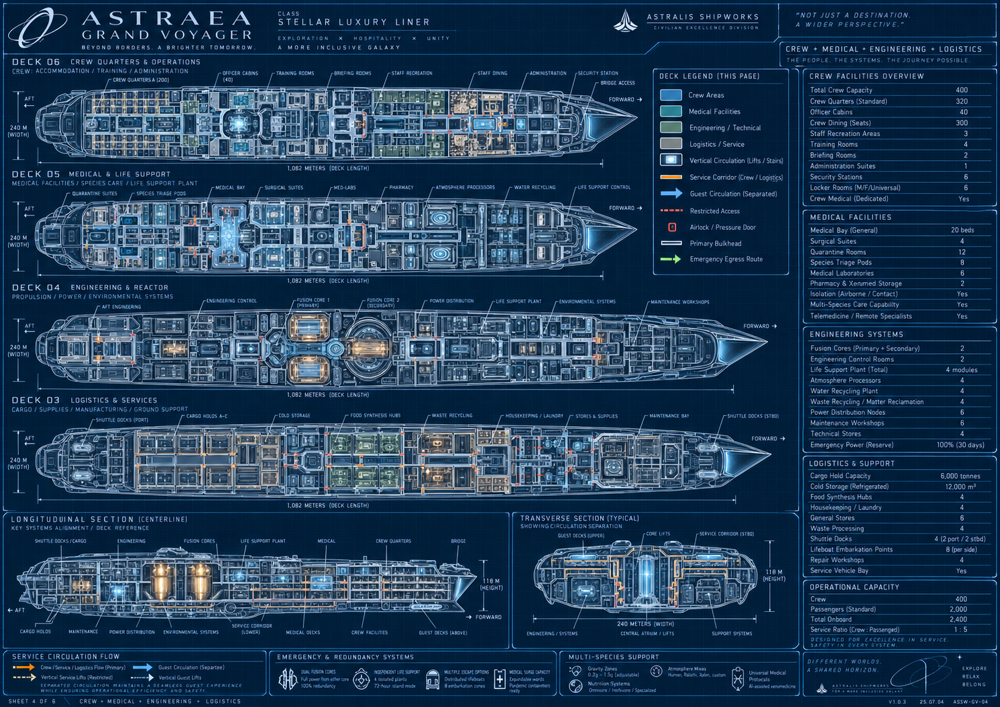

Reference plate 2. Read the separated public and service circulation, the presence of stores and laundry, and the relationship between crew homes and work. In the canonical plan, the sheet's logistics D03 becomes D01, engineering D04 becomes D02, and crew D06 becomes D03. Medical remains D05. Capacity and room-label inconsistencies are resolved by the binding crew and passenger ledger.

### Public activity reference

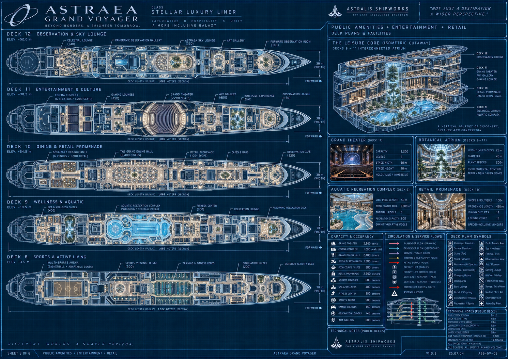

Reference plate 3. Retain the range of dining, culture, sports, water, retail and observation functions. Canonical public roles are D07 sports, D08 aquatic, D09 retail, D10 dining, D11 culture and D12 observation. The grand theater is 2,200 places and six cinemas total 1,200; dining is independently capped at 2,200 places. Different printed dining subtotals must not be added into a second capacity target.

### Habitat reference

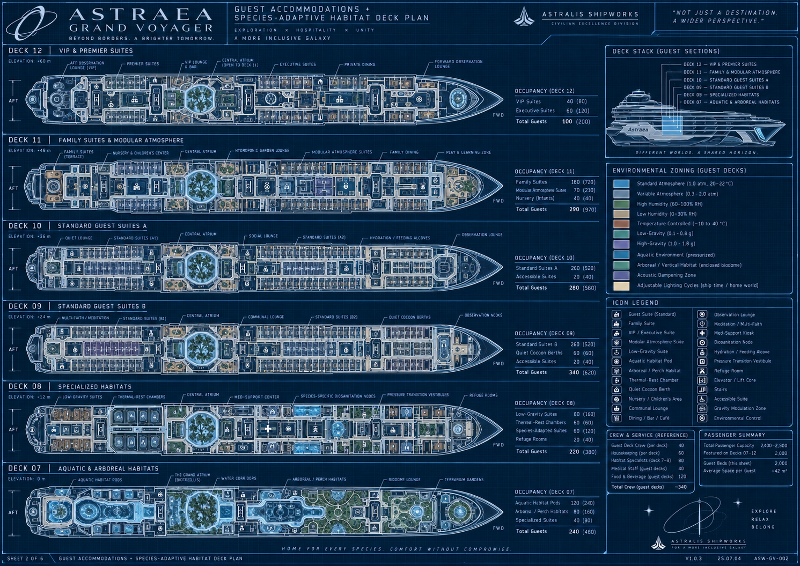

Reference plate 4. Use environmental variety, local commons, adaptive rest and repeated home modules. The six accommodation decks are canonically D04, D13, D14, D15, D16 and D17. The image's per-deck totals conflict with the approved ledger and are not a generation recipe. Childcare and day-activity spaces do not add unassigned overnight occupants.

### Inhabited atrium reference

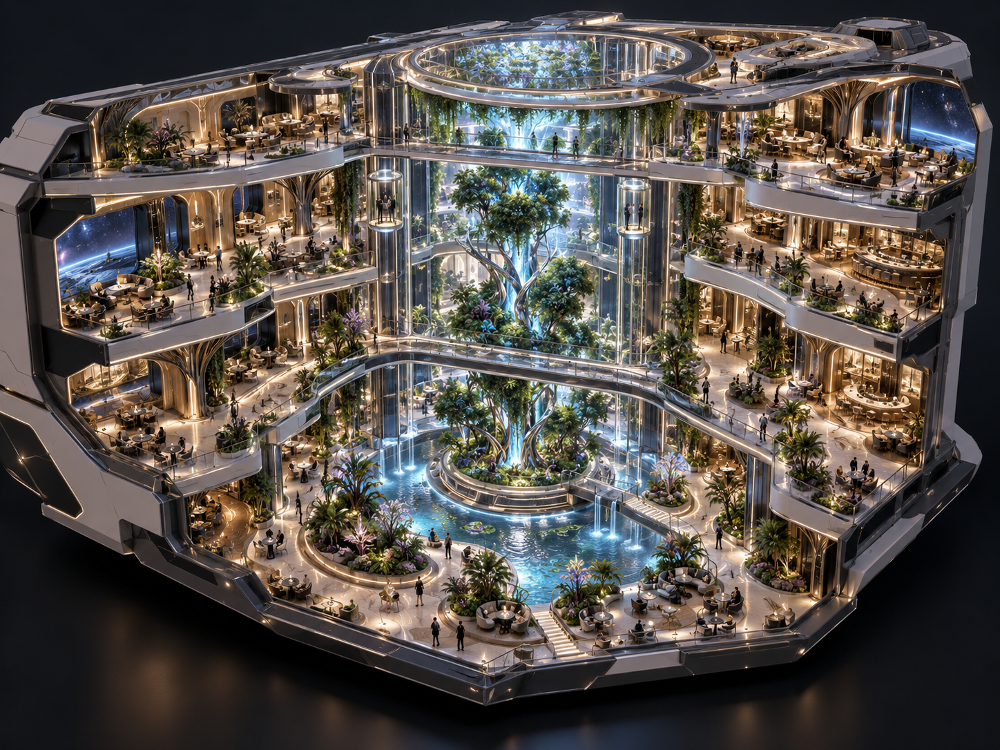

Reference plate 5. The useful hierarchy is a grounded tree and island, shaped occupied terraces, a few purposeful crossing routes, vertical lift landmarks, water and a visible upper volume. Translate that hierarchy into original low-poly forms and controlled material detail. Do not imitate the reference's realistic rendering or assume every visible capsule is already a working lift in the game.

### Architectural threshold reference

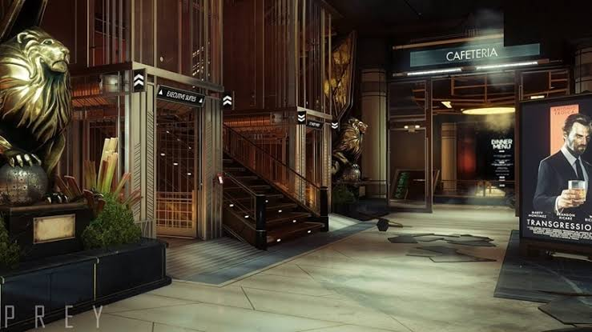

Reference plate 6. User-supplied Prey image. Study deep portals, vertical fins, layered surfaces, a weighted focal object, clear circulation and local edge lighting. Do not reproduce the lions, signs, poster, logos or exact staging. Astraea needs original SunCorp and alien-cultural motifs with its own proportions and retro materials.

### Close scale material and light reference

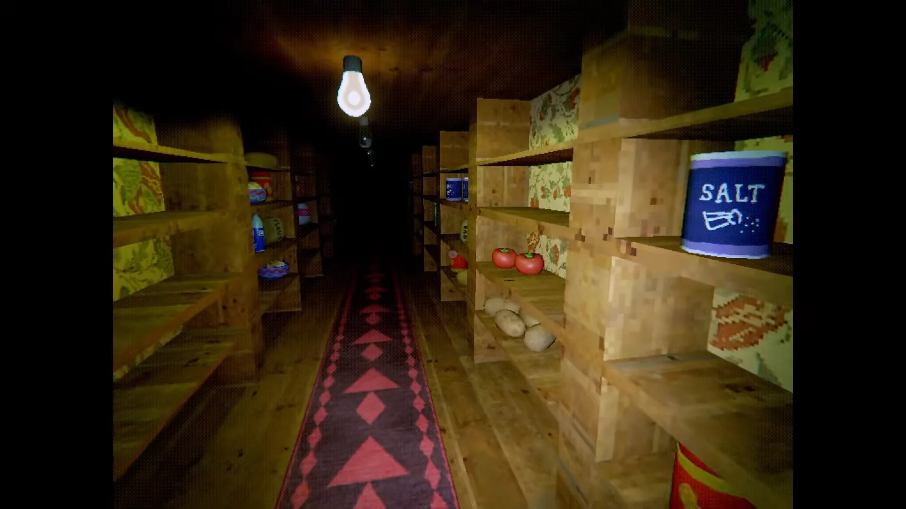

Reference plate 7. User-supplied Creature Kitchen image. Study the visible bulb, nearby warm surfaces fading into depth, shaped labeled containers, intimate shelving and patterned low-resolution materials. The lesson is crafted local form and source light. A uniform world light or stronger screen noise cannot replace it.

### Inhabited multi level circulation reference

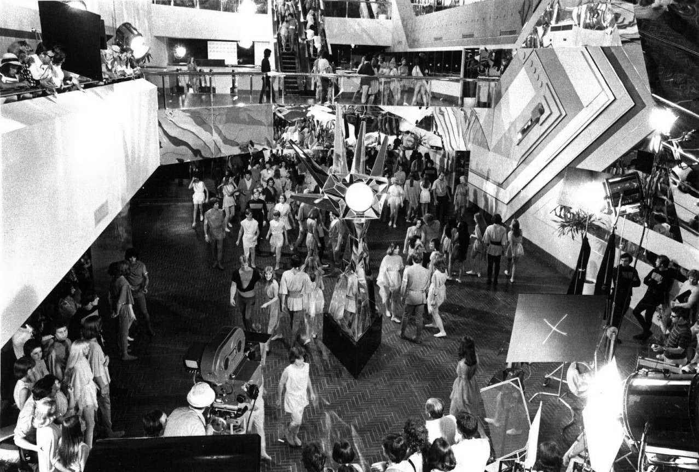

Reference plate 8. User-supplied Logan’s Run image. The confirmed lesson is an interior with groups of people moving through connected levels, views between balconies, and gathering places organized around central focal elements. Stairs, escalators and lifts should make routes and different destinations understandable. This is a spatial and population-composition influence, not permission to copy film characters, plot, costumes or exact sets. All Astraea geometry, materials and rendering retain the original low-poly CRT-dithered style.

The reference strengthens a main-game acceptance question: can a player see where people are going, why they gather, and how an upper-level destination connects to their own level? Large crowd counts in the simulation are insufficient if the visible space feels empty or disconnected. Escalators and additional functional atrium lifts are a design direction to resolve and implement, not already verified gameplay features.

### Compact personal space reference

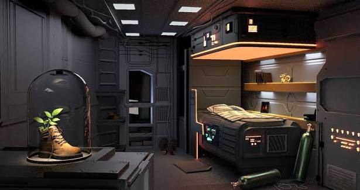

Reference plate 9. User-supplied compact cabin image. Study how a built-in berth, storage, task light and one personal focal object make a small room feel used. The exposed service layer and coordinated material hierarchy give the room purpose without scattering decorative clutter. Translate the organization into original staff spaces and species-appropriate fixtures; retain the project’s low-poly CRT-dithered finish.

### Social observation lounge reference

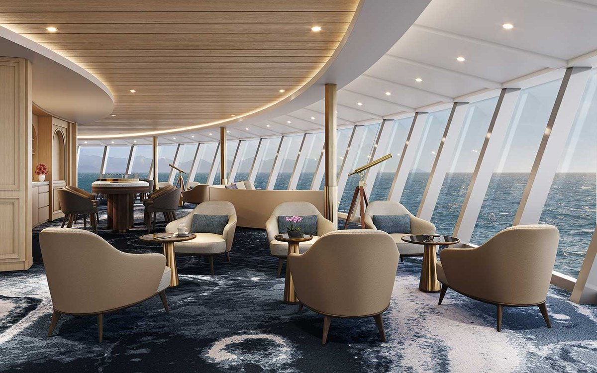

Reference plate 10. User-supplied lounge image. Conversation-sized seating groups share a broad view, with tables close enough to use and a ceiling curve that organizes the room. Study human-scale density, circulation between clusters, and the continuity of wood, fabric and light. Adapt the seating to diverse alien bodies and the actual hull allocation; the photorealistic rendering is not the project target.

### Integrated dining edge reference

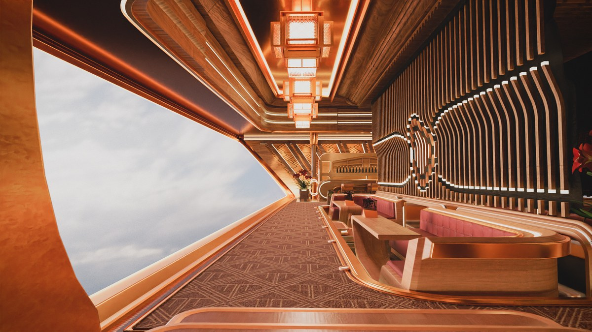

Reference plate 11. User-supplied dining interior. Booths, privacy screens, ceiling ribs, pendant fixtures and the window-side route work as one composition. Study the repeated rhythm and layered thresholds, then simplify motifs and material detail for the low-resolution view. Useful density must preserve table access, supported poses, cleaning stances and a loaded-cart route rather than copy this exact plan or ornament.

### Shared vertical focal space reference

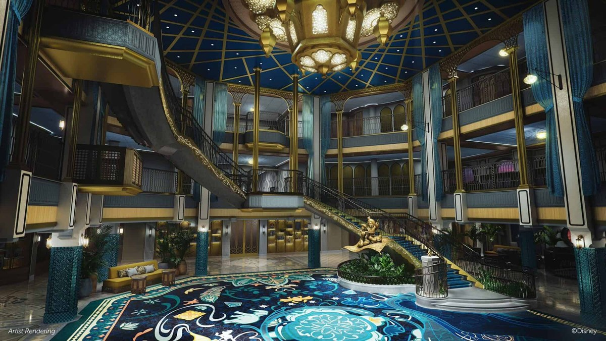

Reference plate 12. User-supplied hospitality atrium concept, visibly credited to Disney. Study how stairs, landings, balconies, a central gathering place and a dominant ceiling feature make the open volume legible as one room. The transferable lesson is coordinated hierarchy and active edges. Astraea uses its own botanical focal sequence, motifs and low-poly CRT materials; characters, branded decoration and exact staging remain reference content.

Together these four plates set a review question: do enclosure, furnishing, light, material and movement support the same purpose at a believable scale? They guide the full ship’s authored spaces. They establish no new capacity or final room plan. The later Composition04 direction approval remains scoped to propagation and refinement.

## 31 Glossary source register and change log

### Glossary

| Term | Meaning in this project |
|---|---|
| Accommodation | One passenger unit with a fixed approved berth count |
| Berth | One real assigned place to sleep, not a generic occupancy number |
| Species | One of the six canonical peoples; distinct from a rig or habitat index |
| Habitat profile | Physical room/rest support type; the eight legacy profiles are not eight species |
| Party | Occupants linked through an accommodation or proposed social group |
| Incident | Unique source-attributed cleaning work; includes canonical species residues once implemented |
| Claim | Protection of accepted or partial player work from background resolution |
| Care anchor | Reachable position for residue or the player working on it |
| Activity anchor | A physical place for eating, resting, viewing, browsing or another activity |
| Model record | Persistent simulation truth for a person or system |
| Rendered actor | Temporary visible representation of a persistent person |
| Townline | The ship's service transit with five longitudinal catchments |
| Express deck travel | Current directory-based player transition between decks |
| Gallery lift | Actual three-stop moving theater platform |
| Layout signature | Check preventing a save from silently loading into incompatible geometry |
| cr | Current fictional currency label |
| Remittance | A fictional transfer from bank to cumulative sent-home total |
| Local approval | Acceptance of a specific reviewed part, not all dependent or adjacent content |

### Source register

The source register names project evidence so the master can be maintained when implementation changes. Repository paths are relative to the main Astraea project. Reference images were supplied for creative direction and remain distinct from production assets.

| Source | Scope |
|---|---|
| Creative direction through 1 October 2026 | Confirmed player premise, ship counts, fiction, physics, art influences, latest style clarification and local alcove approval |
| docs/SHIP_DESIGN.md | Canonical eighteen deck map, capacity, elevations and living-atrium revision |
| docs/GUEST_SIMULATION.md | Population, needs, schedules, reservations, incidents, crew and state contracts |
| docs/AUDITORIUMS.md | Theater/cinema capacities, geometry, programs and focused acceptance |
| README.md and project.godot | Main build entry, controls, renderer, current scope and limits |
| scripts/full_game.gd and scripts/main.gd | Core interaction, finances, upgrades, transit, saves and settings |
| scripts/ship.gd and scripts/living_atrium.gd | Registration, room construction, routes, fixtures and rebuilt architecture |
| scripts/guest_life.gd | Persistent identities, needs, activities, claims, crew and animation |
| scripts/auditoriums.gd | Venue registration, programs and gallery platform |
| tests/guest_model_tests.gd | Current full-day model and state verification |
| reviews/main_flow_review_output.txt | Actual main-scene cleaning, fresh-load, economy and overnight sequence |
| artifacts/full-qa-results.txt | Main build counts, deck loads and core assertions |
| artifacts/gallery-ride-results.json | Physical gallery-lift first-stop ride with player, cart and bottles |
| artifacts/spatial-living-atrium.log | Rebuilt D04/D06/D13/D14 route and support checks |
| artifacts/spatial-living-atrium-public.log | Later public-deck failures and passing unaffected checks |
| artifacts/spatial-central-recheck.log | D03 repair verification and original D09 approach diagnosis |
| artifacts/spatial-retail-recheck.log | Focused D09 repair pass covering 110 routes and 8,144 floor samples |
| reviews/current-guest-regression.txt | Retained current eighteen deck model regression output |
| reviews/fresh_visual_judgment.md | Scoped independent visual findings across named revisions |
| Current retained guest output from 1 October 00:19 UTC | Eighteen deck full-day, meals, crew, commerce, water and render-budget evidence |
| Current registry layout overview and companion atlas | Actual room footprints and authored circulation exported on 1 October 2026 |
| Governing architecture brief supplied on 1 October 2026 | Ten-section user-authored refinement brief; summarized in chapter 32 and retained with the editable source |
| Destination review coverage register | Frozen separate spatial capacity and gameplay baseline reviews by stable ID |
| Supplied overview and three blueprint sheets | Scale, program, shape and spatial reference with corrected text precedence |
| Supplied atrium Prey Creature Kitchen and Logan’s Run images | Composition, architectural hierarchy, craft, local lighting and inhabited multi-level circulation references |
| Four additional interior images supplied on 1 October 2026 | Compact personal space, social lounge, integrated dining edge and multi-level focal space; composition and material references |
| Current_Phase_Direction.txt | Complete user-authored current-phase clarification: full ship and autonomous life before storyline and exact gameplay detail |
| Species_Canon_User.txt and docs/SPECIES_CANON.md | Exact six-species user roster and canonical implications, including Humans, aquatic Baelins, gruesome molting and Mindo sentience |

### Change log

| Version | Date | Change |
|---|---|---|
| 0.1 | 1 October 2026 | First consolidated master covering confirmed design, current implementation, proposed systems, production needs and acceptance gates |
| 0.1 clarification | 1 October 2026 | Added explicit reference-composition versus project-rendering distinction and provisional care-alcove approval only |
| 0.1 architecture update | 1 October 2026 | Added purposeful open-volume and room-shape criteria, exhaustive destination review governance and Logan’s Run circulation reference |
| 0.1 evidence update | 1 October 2026 | Distinguished current guest-model and route evidence from predecessor reports; added the frozen exhaustive destination panel baseline |
| 0.2 | 1 October 2026 | Prioritized full ship and autonomous life, deferred exact gameplay/story, and added four references. Approval was still open at that checkpoint. |
| 0.3 | 1 October 2026 | Replaced the roster with six confirmed species across habitats, needs, families, cleaning, animation and writing. Preserved counts; marked runtime migration pending. Recorded later Composition04 direction approval only; retained dated evidence. |

## 32 Governing architectural requirements

Status: CONFIRMED governing brief supplied on 1 October 2026. This chapter maps its ten clauses to the master design and the next implementation gate. The full user-authored brief is retained with the editable source as Governing_Architecture_Brief.txt. It governs the architectural refinement of the existing project, not a replacement ship or a wholesale rewrite.

### Authority and interpretation

Modular construction must support authored spaces. Repeat compatible components rather than identical rectangular experiences. The atlas records allocation envelopes and simplified spatial information; inspect the actual builders and live branch before deciding an interior is a box or changing a footprint. The latest live implementation takes precedence for what exists, and meaningful differences from the recorded atlas baseline must be reported instead of overwritten.

The blueprint and diorama remain architectural references, while the low-poly, early-2000s, CRT-dithered project style governs final geometry, materials and rendering. Creature Kitchen is an appearance reference, not a claim about exact shader internals. The established 890 Jump influence concerns the luxury-liner fantasy; Astraea retains its own original ship design and assets. Proposed numerical trials in the brief remain trials where a working project standard already exists.

### Clause mapping

| Clause | Governing requirement | Master connection and acceptance |
|---|---|---|
| 1 Inspect and protect | Inspect the live project, instructions and owners of registration, geometry, rendering, transit, physics and saves. Record baselines and protect unrelated work. Preserve engine version, renderer, main scene, controls and identities. | Chapters 25 to 28. Improve existing builders; no competing controller, registry, world state or postprocessing stack. |
| 2 Spatial baseline | Verify exact capacity, nonuniform elevations, the D02 to D17 opening, four principal terraces, limited crossings, protected portals, tram and theater exclusions against the live branch. | Chapters 4 and 5. Preserve usable berths and interfaces; report deviations rather than imposing a conceptual grid. |
| 3 Purposeful openness | Every major void needs a purpose, overlooking destinations, active edges, useful sightlines and a reason for its dimensions. Compose one botanical and water focal sequence while retaining breathing room. | Chapters 5 and 21. No bridge grid, indiscriminately oversized tree, competing full-height spectacle or invented exterior opening through occupied rooms. |
| 4 Architectural language | Every room family needs a meaningful plan decision plus a sectional or threshold decision serving use, privacy, view, circulation or species support. Coordinate walls, ceiling, light and built-ins. | Chapters 6 and 21. A curved sofa, random diagonal or themed props inside an unchanged box is insufficient; functional straight surfaces can remain. |
| 5 Destination identities | Differentiate the D02 garden basin, D06 botanical terrace, D09 retail, D12 gallery/library and D16 family gardens within actual allocations. Keep smaller galleries quieter and purposeful. | Chapters 4 to 7. A space remains identifiable with its sign hidden. Do not add businesses or move all 100 addressed shops onto the ring. |
| 6 Compatible modular kit | Use existing scene/procedural conventions and compact wall, arc, floor, ceiling, junction, alcove, portal, fascia, rail and integrated-seat families. Include proper transition pieces. | Chapters 21 and 25. Stable pivots, seams, UV scale and deterministic variants; backward-compatible local profiles rather than a second registry. |
| 7 Art at every layer | Spend geometry on silhouette and use. Keep coherent low-resolution texture density, restrained wear, patterned materials, muted luxury finishes and inviting local light. | Chapter 21. Trial texture sizes only where no standard exists; avoid flat-color substitution, photorealistic gloss and indiscriminate retro effects. |
| 8 Existing display pipeline | Reuse the viewport, grading, dithering and CRT stages; preserve crisp UI and correct input mapping. Keep effects adjustable and inspect motion. | Chapters 21 and 24. Effects-off architecture still looks authored; no mosaic overlay offered as proof of low-resolution rendering. |
| 9 Honest integration | Test real loaded-cart sizes, smooth navigation beneath segmented visuals, faithful simplified collision, exposed cross-level views, spatial batching and bounded light/overdraw costs. | Chapters 14, 25 and 28. Do not fill holes with convex collision, batch persistent props as static, hide open air with fake occluders or claim unmeasured platform performance. |
| 10 Checkpoint rollout | Audit first, author one connected room and terrace, review it, compose the atrium, prove distinct room-family repeatability, then expand with integrated evidence. | Chapter 27. No shipwide blind rollout, facade-only pass, detached demonstration or generated concept art substituted for in-engine proof. |

### Protected spatial details

The recorded baseline is a 96 by 128 m D02 through D17 slab opening with sixteen visible levels. The four strong terrace bands are D06, D09, D12 and D16; twelve galleries remain smaller. Preserve actual nonuniform elevations and avoid turning the diorama into a literal four-story replacement. The center stays clear, with optional narrow D09/D12 crossings rather than a full crossing grid.

The atlas records 16 m fore and aft entry aprons, side portals near X plus or minus 52 m at Z zero, and cross-street portals at Z plus or minus 42 m. These are verification references; later documented route repairs must be reconciled with the live branch before any change. Keep neighboring homes, privacy, environmental equipment and the theater D12 through D14 openings intact.

Protect the starboard service-tram swept path through X/Z points (0, −72), (0, −56), (40, −52), (40, 52), (0, 56) and (0, 72), including the loaded cart and boarding approaches. Retain stops at Z −432, −216, −72, 216 and 432 m and central express arrival at X 5.5, Z −72 m unless a documented live revision supersedes them. A track centerline alone is insufficient clearance evidence.

### Immediate room and terrace checkpoint

The D09 Composition04 direction is approved for propagation and substantial further refinement. It remains a local architectural checkpoint within the full-ship and autonomous-life phase; final D09 quality and whole-ship acceptance remain open. The user requested a more refined, alive, filled yet pixelated aesthetic throughout Astraea.

Select one real D09 destination or eligible connected frontage near an atrium entrance. Work within its existing allocation and build an approximately 20 to 30 m connected terrace segment in the main scene. The sample includes a non-box spatial arrangement, designed ceiling or threshold, planted seating pocket, coordinated railing/soffit family and a framed cross-atrium view. Keep the actual controller, physics, transit context and retro pipeline.

Review simple-material plan, section and eye-level views first: is the room purpose understandable without signs? Then finish materials, fixture lighting and selected props, and compare CRT on and off. Do not propagate an attractive facade that hides an unchanged interior. With direction approved, continue refinement, compose the four terraces and prove distinct profiles in a standard suite, family suite, specialty habitat and another public room while preserving their berths and access.

### Required evidence and handoff

Test normal arrival, walking, loaded-cart travel, tram passage, existing inter-deck travel, interactions, persistence, navigation where implemented and relevant streaming changes. Check counts, floor openings, blocked interfaces, collision seams, shader errors, input mapping and comparable performance. Keep plan and section drawings, a diagnostic cutaway and repeatable before/after normal-play captures including the sample interior, entry, D06, D09, a downward D12 view and D16.

Deliver the actual changed components, room-profile/module summary, scoped test results, comparable captures, remaining limitations and a reversible change path. Distinguish complete, placeholder, estimated and untested work. Ask for a decision only when a genuine conflict would change a protected interface, capacity or engineering constraint. The full ship remains a work in progress; a successful connected sample is the gate for propagation, not proof that every room has been reauthored.

## 33 Dated destination review baseline

Status: VERIFIED narrow registry, source, model and physical-query results; UNFINISHED architectural, whole-population service and normal-play acceptance. Baseline recorded on 1 October 2026 before the controlled D09 architectural refinement. Later repairs must retain their own matching evidence rather than rewrite this history.

### Coverage and scope

All 1,462 registered destinations have separate stable-ID rows in each spatial, capacity and gameplay review. Capacity also covers 189 aggregate zones, including deck/program groups, accommodation classes, dining and entertainment groups, theater tiers, atrium levels and transit/circulation. This is exhaustive registry/source coverage, not 1,462 individual rendered visits. The gameplay panel performed no manual walkthroughs. Narrow passing checks remain attached to rows that can still be failed or unverified overall.

| Panel | Established by the frozen review | Open acceptance |
|---|---|---|
| Spatial | All 1,462 ordinary-player routes and 111,435 sampled floor positions pass on the repaired main-scene snapshot. All 3,064 automatic leaves have correct transforms, 1,532 closed doorways block the player query, and 1,585 open threshold/cart/turn screens pass. | 25 broad-body routes still fail the 0.65 m radius screen. Architectural identity and visibly inhabited continuous atrium circulation remain unapproved. Full loaded spring-cart driving is not established by query sweeps. |
| Capacity | Exact passenger and crew inventory, 2,400 unique assigned bed anchors, 2,200 dining anchors and 3,400 entertainment anchors pass their narrow consistency checks. | Crew meals, breakroom loading, changing-room semantics, full service windows, queue overload and physical use of every place remain unresolved or unverified. |
| Gameplay | Core cart, finite cleaner, causal/claimed work, wages, save state, bounded guest life and ambient activities are implemented. Existing model regressions pass their assertions. | Ordinary causal cleaning covers only 210 destinations. Residential/staff turnover, midship supplies, specialty program hooks and normal-play access coverage remain incomplete. |

### Priority issues

- Broad-body access: 21 amenity or staff routes and four retail routes fail the wider-envelope screen, generally near furniture. Ordinary-player clearance does not certify every alien body or appendage
- Crew dining: the 300-place D03 dining room has no meal anchors or crew meal routine. Passenger tests do not demonstrate feeding all 2,400 occupants
- Crew breaks: all crew share one break destination. The 17:30 seed places 266 crew on 28 exact positions there, with only eight chairs and a 9 m bench modeled. Admission and alternative break destinations need design and implementation
- Changing function: D08 Universal changing is built and scheduled as an aquatic bath. A changing/locker/towel service is not implemented by its label
- Work coverage: only 200 amenity destinations and ten meal venues enter normal causal incident generation. The other 1,252 records include homes and staff/technical destinations without ordinary work-originated traces
- Local supplies: the six residential decks omit central cupboards. Thirteen eligible cleaning destinations exceed the panel’s 150 m straight-line service screen. This is a diagnostic threshold, not a measured optimal journey or an approved new balance rule
- Recovery height: theater-gallery cart recovery was found to force ground-level height. A later floor-aware source repair was reported; this gameplay panel did not revalidate it. Test both galleries with spent stock and loose bottles
- Program identity: clinics, laboratories, some staff destinations and upper theater-gallery records lack their named specialist activity. Ordinary visits and decorative props must not be described as complete services

### What the passing model does not establish

The fresh continuous-day test shows that all 2,000 passengers ate and slept at least once and satisfies its dinner assertion. It records 4,444 meal completions, not a proven 6,000 completed three-meal service. Reservation and approach checks do not establish saturated queue behavior or full-capacity turnover. Theater visitors use viewing anchors rather than a reserved-chair audience scheduler.

There are 243 destinations without numeric capacity metadata. Their capacity is unknown, not zero. Shared activity points and a bounded visible crowd do not prove usable full-load occupancy. Home support checks compare assigned metadata; they do not independently validate alien biology or operational environmental controls. Crew accommodation support is less developed than passenger support.

### Architecture and next evidence

The atlas rectangles remain allocation envelopes. The architectural critique also inspected actual builders: many macro spaces share a shell, suites share a plan with different rest fixtures, and shops and crew cabins use repeated plans. This supports the need for authored room-family profiles; it does not authorize changing the hull, capacity or protected registry. Residual floor-area fractions include streets, galleries, support space and voids and must not be called empty space without actual review.

Proceed through the governing connected D09 room-plus-terrace checkpoint. Preserve the verified door repair and rerun affected broad-body, care, transit and persistence checks after each relevant change. The next evidence must connect intended purpose, usable capacity, genuine activity and architectural identity in the same actual place.
